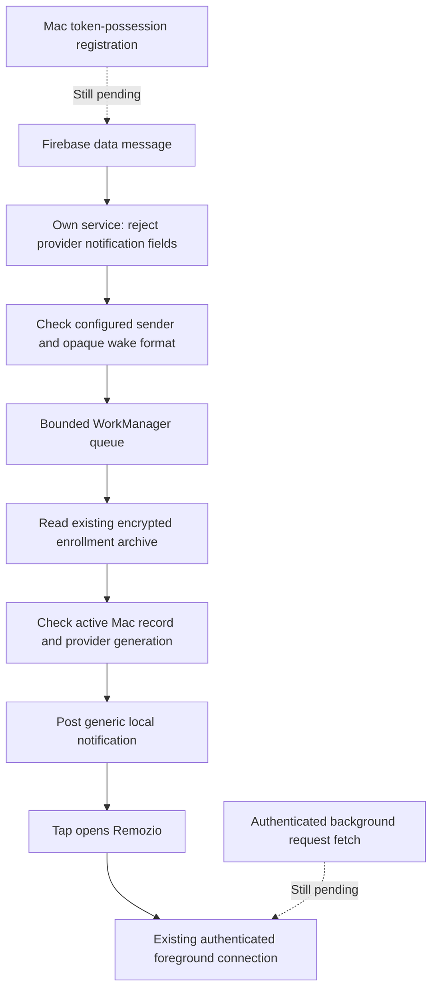

# Android Firebase client

The app can import public Firebase client options at runtime. It does not need a project-specific build.
Mac delivery registration and authenticated background request fetching remain follow-up work. Client registration alone does not enable remote approval alerts.

## Setup and ownership

In Settings, import the Android `google-services.json` file for the installed package. Debug builds use `dev.remozio.android.debug`. Production uses `dev.remozio.android`.
The importer selects exactly one matching client. It rejects service-account documents, oversized input, malformed UTF-8, excessive nesting and ambiguous client entries.
Server credentials stay on the Mac. Do not import a service-account key into the phone.

The app stores the selected public options in private storage excluded from backups. Import explicitly enables the client. Startup restores that choice.
No Firebase app starts before this choice. Automatic initialization, analytics collection, notification delegation and installation-ID direct delivery are disabled in the manifest.

The connection switch disables client initialization and rejects later messages. Enabling the same client works without restarting the app.
Importing a different client saves the new options and stops the old client. The new client starts in the next app process. Pairing records remain unchanged.
Importing the same file preserves the current enabled setting. Invalid input leaves the current configuration intact.

Each configuration change has a new local generation. Each token request also has a separate attempt identifier. Late callbacks cannot replace current state.
Tokens are private delivery addresses. They do not grant enrollment, fetch or decision authority. No token appears in settings, logs or notification content.

## Delivery boundary

Only opaque wake identifiers and enrollment tags enter the queue. A message supplies no endpoint, request details or decision action.
Unknown tags and prepared or removed enrollment records produce no alert. Every worker reads the current archive under the shared enrollment mutex.
Removing a pairing cancels its notification by stable local record ID, including after a cold process start.
Disabling or replacing the provider prevents an old worker from publishing a new notification.

WorkManager admits expedited work with ordinary-work fallback when quota is unavailable. It coalesces unfinished work per Mac and provider generation.
The ingress checks a limit of 256 unfinished jobs. Queue errors and capacity refusal produce coarse local diagnostics. Completed ignored wakes replace the queued state with an explicit no-new-alert result.
These diagnostics describe recent ingress and worker results, not the current queue length. They contain no tokens or request identifiers.

The router keeps duplicate and alert-throttle state in process memory. It does not provide durable duplicate suppression across process restarts.
Notifications use a stable local record tag and expire after 60 seconds. Their expiry makes no claim about a request's actual state.
Android permission, channel settings, Do Not Disturb and scheduling still control visibility. A successful post does not prove that the user saw an alert.

## SDK contract

Firebase Messaging 26.0.0 uses the existing registration-token API for the Mac's HTTP v1 sender. The installation-ID delivery migration is separate work.
The service overrides the pinned SDK's public `handleIntent` hook. It rejects both provider notification prefixes before SDK rendering.
Rejected deliveries still call the same Google Play services acknowledgement used by the SDK. They never enter SDK notification rendering.
This adapter pins the SDK's Play services version. [Direct acknowledgement API use](https://developers.google.com/android/reference/com/google/android/gms/cloudmessaging/Rpc) has no supported compatibility contract.
The manifest removes the fallback Firebase service. SDK upgrades must recheck the hook, acknowledgement and packaged manifest.

References: [Firebase initialization options](https://firebase.google.com/support/guides/init-options),
[Android message receipt](https://firebase.google.com/docs/cloud-messaging/android/receive),
[SDK changes](https://github.com/firebase/firebase-android-sdk/blob/main/firebase-messaging/CHANGELOG.md),
and [WorkManager execution](https://developer.android.com/topic/libraries/architecture/workmanager/how-to/define-work).

## Validation and remaining work

Twenty-four JVM tests cover import boundaries, configuration recovery, callback fencing and saved-Mac notification routing.
The packaged debug manifest verifies the disabled initializers and the exclusive application messaging service.
A disposable Android 17 emulator provides phone, tablet, dark-theme and large-text layout evidence. It uses no real provider credentials or enrolled Mac.

No real FCM delivery, token-possession registration, Doze behavior or physical Pixel test is claimed.
The worker does not answer token challenges or perform an authenticated background fetch. Those integrations must land before remote delivery is complete.
