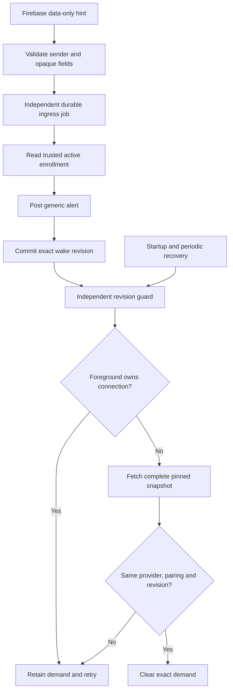

# Android background request checks

The app now connects push ingress to its durable wake journal and enrolled snapshot owner.
This path does not approve requests. Mac delivery registration still needs integration.

## Runtime path



The notification attempt precedes journal writes and network work. A blocked notification does not prevent a request check.
A failed journal write retains the posted alert and permits a silent retry of that exact hint.
A delayed retry cannot ring again merely because the alert interval elapsed.

The journal stores only provider generation, opaque enrollment tag and random revision.
The private WorkManager inputs contain only opaque hint fields and provider generation.
Only the trusted archive supplies enrollment, keys and routes.

## Ownership and races

A new journal revision has its own unique work name. It never depends on an older worker.
An identical revision can coalesce. A new revision cannot disappear through KEEP on an older Mac job.

Each trusted enrollment has one bounded fetch entry. A busy entry returns retry without occupying another worker slot.
Its mutex remains held through transport cleanup and exact journal completion.
The snapshot uses the same connection owner as the foreground inbox. Foreground activity preempts background fetches.

```mermaid
sequenceDiagram
    participant Push
    participant Journal
    participant Old as Older guard
    participant New as New guard
    Push->>Journal: Mark revision A
    Old->>Journal: Capture A
    Push->>Journal: Mark revision B
    Push->>New: Enqueue independent guard B
    Old->>Journal: Complete A
    Journal-->>Old: Refuse; B remains
    New->>Journal: Capture B
    New->>New: Complete authenticated snapshot
    New->>Journal: Complete B
```

Provider changes cancel suspended fetches through the observed generation. Publication still requires the provider lock and a fresh archive check.
Pairing changes invalidate fetch entries before committing trust changes. An older fetch cannot clear replacement demand.
A failed or uncertain journal owner closes. Reopening reads the durable file without resetting corrupt state.

## Recovery and settings

Startup installs periodic recovery before attempting immediate reconciliation.
Recovery covers a journal commit followed by process exit or enqueue failure.
Work with generation tags is cancelled when its provider generation retires.
Retained v1 ingress jobs lack generation tags. They share the ingress limit with v2 jobs until completion or cancellation.
Startup preserves their pending hints. Their worker checks the current provider before processing a hint.

Ingress and fetch queues have separate admission owners. Each counts persisted work, unfinished enqueue futures and uncertain calls.
A timed-out enqueue retains capacity until its future finishes. A synchronous uncertain call retains capacity until process restart.
Changing a queue limit preserves those reservations and existing work.

Advanced settings stay collapsed until opened. They expose both queue limits, attempts per job, initial retry delay, snapshot timeout and recovery interval.
The defaults are 256 jobs per queue, five attempts, ten seconds initial delay, thirty seconds per snapshot and fifteen minutes between recovery runs.
Snapshot guards do not require validated internet access. The enrolled transport can try the LAN even when Android cannot validate the internet.
Android may delay work. Attempt exhaustion does not clear the journal; later recovery can schedule another guard.
These intervals do not change a request's expiry or make a retained request current.

## Verification

Five controls passed against the actual AndroidWakeWork code in the WorkManager test runtime on an API 37 emulator.
The worker bodies were gated test substitutes. The controls exercised independent ingress, revision guards, resizing, startup retirement and retained v1 jobs during an upgrade.
The upgrade control checks shared v1/v2 capacity, preservation across startup and capacity released after legacy cancellation.
The [evidence](evidence/2026-10-17-android-background-work.json) records the tested source hashes and exact limits of this result.

Host controls cover uncertain commits, generation fencing, trusted pruning, foreground ownership, concurrent wakes, incomplete snapshots and transport cleanup.
Those controls use synthetic enrollment storage and transport. They do not prove real network authentication.

Run the reproducible framework fixture with:

```sh
JAVA_HOME=/path/to/jdk21 ANDROID_HOME=/path/to/sdk python3 scripts/prepare-android-wake-probe.py .build/background-work-probe --probe work
```

Validate and run its compile plan through ATC before claiming an emulator. Save its baseline, run the device plan, restore the baseline and free the lease.

Real FCM delivery, system JobScheduler behavior, quotas, process death, settings interaction and the installed Mac–Pixel approval flow remain untested.
Device-dependent tests wait for the agreed interactive session. No decision is signed or sent by this path.
