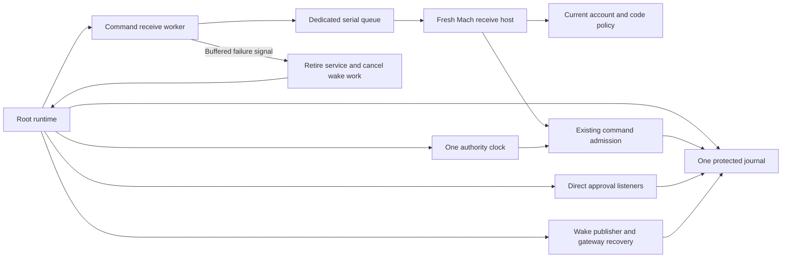
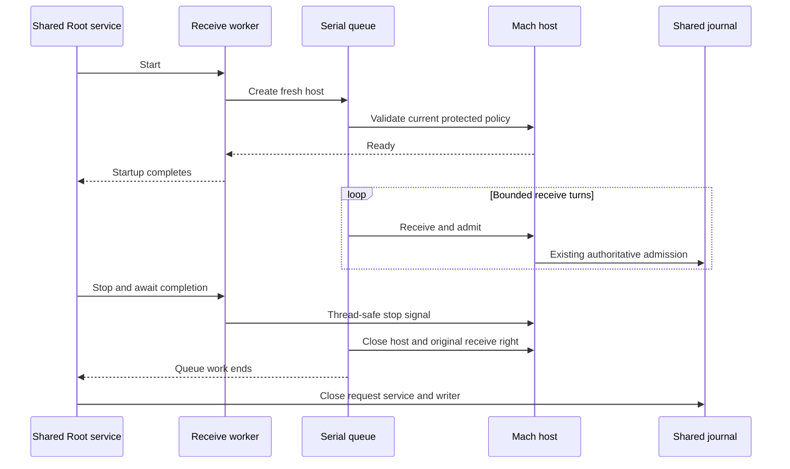

# Authority command receive owner

The shared Root runtime now has a command receive worker. The worker creates, polls, and closes one Mach host on a dedicated serial queue. It uses the existing journal and clock. Blocking Mach receives do not occupy Swift's cooperative executor.



The trusted factory receives the same journal and clock used by direct approvals, presence, and wake publication. Production worker construction requires real and effective Root UID. The fixture constructor changes only this account gate.

The host stays on its queue. Only the thread-safe stop signal crosses the boundary. Queue work retains its ownership state without retaining the worker itself. Dropping the worker signals shutdown.

## Startup and shutdown

Readiness requires a successful current policy read before receiving messages. Readiness grants no command authority. Each receive turn repeats the existing policy checks. The existing admission controller retains request-local refusals and original input ownership.



Concurrent close calls await the same queue work. Shutdown waits for a late factory and the active receive turn. It never destroys the host from another thread. The worker does not close the journal.

Cancelled startup stops any host created late. A service closed during asynchronous startup cannot create a late wake publisher. Failed host policy retires the shared service, including while its gateway is healthy. An owned observer receives a buffered failure signal and cancels wake work immediately. Publication sleeps and retry delays cannot postpone retirement. Gateway recovery does not clear this failure.

Status callbacks are diagnostics. They must return promptly and must not start or stop the worker. Resolve and draft callbacks retain the journal's existing rules against reentry.

## Native check-in evidence

On 2026-10-11, an isolated arm64 probe targeted macOS 26. Swift's Darwin module did not expose `bootstrap_check_in`. A C bridge using `<servers/bootstrap.h>` compiled and linked with `-Wall -Wextra -Werror`. Swift could call that compiled bridge.

A separate normal-user runtime probe used one fresh, undeclared service name. It produced:

```text
check_in_status=0; receive_right_returned=1
```

The probe exited with status 1 because its expected unknown-service result was wrong. A separate process then looked up the exact same name:

```text
post_exit_lookup_status=1102; send_right_returned=0
```

No endpoint remained discoverable after the first process exited. No persistent service plist was written. Neither probe ran as Root or changed sudo/PAM configuration.

**Successful check-in does not prove protected service registration.** The installed job association needs separate validation. Existing client peer and code checks remain required. Do not substitute dynamic registration for the protected installation contract.

The product does not add a check-in bridge or registration fallback in this change. Apple's published launchd source predates the current runtime. The exact current mechanism remains unproven.

## Test evidence

The focused native tests pass 39 cases: ten receive-worker cases, 28 wake-publisher cases, and one existing admission compatibility case. They use anonymous Mach receive rights, software fixture keys, private journals, and synthetic gateway drivers.

| Check | Evidence |
|---|---|
| Native receive ownership | An actual hello message receives a decoded admission-capable reply. |
| Startup validation | Invalid initial policy never reports ready and releases the receive right. |
| Late creation | Close and cancellation await a blocked factory; its late host never reads policy. Cancellation at readiness also closes a retained worker without explicit cleanup. |
| Worker lifetime | Dropping the worker releases its receive right without a self-retention cycle. |
| Shared shutdown | An active policy read can finish before the shared journal closes. |
| Startup race | Closing during readiness prevents creation of a late publisher. |
| Policy retirement | A failure signal interrupts 30-second publication sleeps and retry backoff. Retirement during a gateway handshake prevents the first publication. |
| Observer lifetime | Service deinitialization cancels and drains the observer before closing the journal. The observer does not retain the service. |
| Receipt sampling | Idle polls and hello messages do not sample receipt time. Actual command input samples the provider after receive. |
| Production account gate | A normal account cannot construct the public worker or invoke its host factory. |

The full `./scripts/check.sh` gate passed after the review fixes, including 1,652 core tests, the Debug and Release app builds, and native experiments. All six required Kotlin and Android tasks passed.

The healthy-gateway retirement regression failed before its fix with a timeout. It passes after the publisher checks shared authority retirement before each publication turn.

The handshake regression also failed before its fix: it observed snapshots and wakes after receiver retirement. A second check now runs after the gateway handshake and before initial reconciliation.

The receipt regression observed repeated start-of-poll timestamps before any command input. Receipt sampling now runs inside the authenticated input handler. The fixture verifies sampling time; its normal-user admission remains blocked and does not prove a persisted Root audit event.

Cancellation checks remain inside the active handler. Cancellation normalization also signals stop before returning an error. The readiness fixture proves automatic cleanup with a retained worker; it does not instrument the instruction gap after handler removal.

Two long-sleep regressions failed before the signal fix because cleanup waited for the next polling turn. Both pass with the owned observer. Normal shutdown completes the signal without reporting failure.

## Remaining product integration

The Root executable does not activate this factory yet. This change does not dispatch approved commands, select an elevation policy, or install a protected Mach service.

Section 8 of the approved plan requires a user choice between proven native sudoers integration and an explicitly administered Remozio elevation policy. That choice remains pending. A successful `sudo` list check alone does not prove execution-policy equivalence.

Installed job registration, hardware signer restoration, account provisioning, real terminal behavior, and phone validation remain in [issue 286](https://github.com/rock3r/remozio/issues/286). These tests do not replace that evidence.
