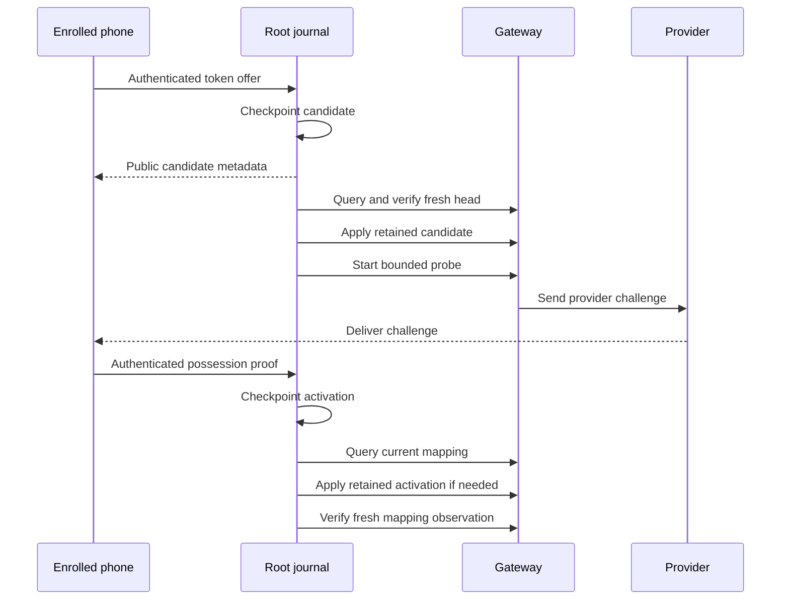

# Root phone push publication

The protected startup option now joins phone registration to the existing Root publication loop.
The loop uses one authenticated gateway control connection.
An absent option retains the existing behavior.
This source does not enable the option in the installed product.

## Publication and recovery

Each turn verifies the gateway head before publishing retained controls.
The Root accepts only history that matches its protected local controls.
A repeated acknowledgment does not create another continuity write.
Candidate and activation replies remain untrusted until their signatures and scopes pass verification.
Every asynchronous boundary rechecks the current publication session, clock, lease, enrollment revision and retained candidate.
A superseded candidate cannot start a new probe after its reply arrives.

A committed mapping survives the original proof deadline.
A missing mapping requires a fresh gateway observation.
Replaying an old activation receipt does not confirm a current mapping.
If repair requires another proof, the Root creates a fresh candidate and challenge.
It retains the enrollment, notification tag and token digest.

An expired pending probe waits for another authenticated phone exchange.
Timer ticks do not create an endless sequence of replacement controls.
The phone recovery path must arrange that exchange when it reconnects.
The existing internal renewal operation remains available for that integration.

## Bounds and diagnostics

A turn publishes for at most the configured number of phones, from 1 through 64.
The owner first snapshots the bounded enrollment set.
The default is 16.
A rotating cursor gives the other phones a later turn.
New retained candidates and activations publish in gateway revision order.
Earlier phone revocations and submission credential controls form an additional barrier.
Registration cannot advance past them, including after their delivery envelopes expire.
Their existing publication or recovery path must first advance the verified gateway head.
This registration loop does not publish or renew those controls itself.
Remaining turn slots poll existing mappings in cursor order.
A rejected activation prevents later controls from advancing past it.
Transient registration rejections retry before later controls advance the shared head.
Ordinary approvals and wake publication continue during these registration retries.
The loop starts each current probe operation once per connection.
The gateway retains its independent provider retry and resource limits.

Optional registration failure does not retire a healthy request owner.
Clock, lease or owner failure still closes publication.
Local diagnostics contain only fixed enum values.
A completed turn does not claim a current mapping or successful phone delivery.
A rejected query remains ambiguous and is retried on the same connection.
It does not prove that the gateway lacks support.
Transient apply failures retain the committed activation.
Replacement after a rejection requires local signed expiry and another fresh absent observation.
An older gateway can reject optional mapping queries while keeping ordinary wake control usable.

## Evidence and remaining integration

The [recorded component evidence](evidence/2026-10-17-phone-push-publication-components.json) binds the results to the source.
The complete native/Python gate and six required ATC tasks passed.
The evidence records the complete native suite and its explicit GUI experiment skip.
The component controls use software fixture keys, real SQLite journals and the continuity store.
The gateway coordinator is real; the provider and Root channel driver are synthetic.
Controls cover publication, proof commit, activation, provider invalidation and fresh-proof repair.
They also cover three phones, rejected candidates, expired probes, invalid signatures, lease expiry and owner retirement.
Forty expiry intervals create no additional candidate or continuity checkpoint.

Android provider-only challenge processing and current metadata recovery remain separate integration work.
App settings and protected setup must still enable and expose the configuration.
This evidence does not establish hardware startup, installed services, actual FCM delivery or physical phone behavior.
The supervised Mac–Pixel session remains required.
