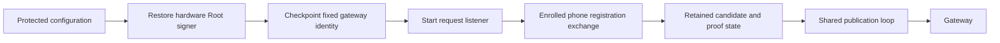

# Root startup for phone push registration

This source adds an optional startup configuration and fresh gateway mapping queries.
It does not enable push registration in the installed product.

## Startup and compatibility

The optional configuration supplies the provider project, sender and Android package.
It also supplies a separate gateway public key and bounded candidate policy.
The Root key must match the configured Mac and account.
The gateway key must differ from the Root key.

An absent configuration retains the existing startup version and exact encoding.
An enabled configuration uses startup version 2 and adds field 11.
The request, presence and gateway journal share one Root clock epoch.
The owner checkpoints the gateway identity before any listener starts.
A checkpoint failure retires the owner and withholds the result.

## Registration lifetime

The Root can read its current retained candidate after a lost response or restart.
This internal state includes provider data and must not enter an ordinary phone reply.
An expired, unconsumed candidate can renew with a new challenge and candidate identifier.
Renewal retains the phone enrollment and still requires provider possession proof.

A committed activation does not expire with the original proof window.
Restart or elapsed proof time must not replace a working mapping.
A fresh gateway query is required before deciding that a committed mapping is missing.
The [shared publication loop](authority-phone-push-publication.md) now publishes retained controls and repairs missing mappings.
Phone status recovery remains open.

## Fresh mapping queries

The query shares the existing authenticated Root control connection.
The outer head command and connection version remain unchanged.
The optional inner query uses version 2, kind 4; its reply uses kind 5.
An older gateway rejects that query and keeps the control connection usable.

The query binds the registration, phone, enrollment, candidate and token digest.
It includes a fresh nonce and excludes the provider token and challenge.
The gateway signs its current observation with its separately pinned key.
The signing domain is `Remozio/GatewayMappingState/v1` followed by a NUL byte.
A present mapping includes the original Root activation signature.
The Root verifies both signatures, the exact scope, nonce and query deadline.
A historical receipt alone cannot confirm the current mapping.
The query does not contact FCM or establish successful phone delivery.

## Evidence and limits

The [recorded component evidence](evidence/2026-10-17-phone-push-startup-components.json) binds the results to the source.
The complete native/Python gate and six required ATC tasks passed.
Component controls use software fixture keys, SQLite and the continuity store.
They cover startup encoding, checkpoint failure, restart retention and candidate renewal.
Mapping controls cover stale replies, scope mutations, provider invalidation and database reopen.
The coordinator rejects an expired Root lease before signing or contacting a provider.
Legacy endpoint and channel controls retain the connection after optional-query rejection.

These controls do not establish hardware startup, an installed service or real FCM delivery.
The startup evidence predates the shared publication integration.
Provider challenge processing, phone recovery and app settings remain incomplete.
Physical Mac–Pixel validation remains part of the supervised integration session.
