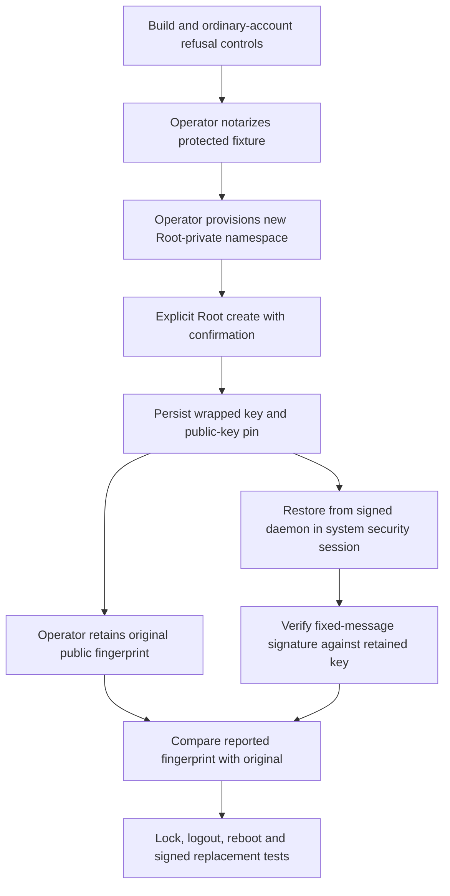

# Disposable enclave key lifecycle

The signed experiment app includes `RemozioLifecycleEnclave` as a fourth helper.
It can create one disposable Secure Enclave key and restore its retained state.
It signs only fixed test data. It exposes no listener or approval interface.
The production app does not select this helper or its storage format.



Only the first node has run.
The diagram describes required tests, not completed connections.

## Commands and boundaries

| Command | Behavior |
| --- | --- |
| `--describe` | Fixed role and capability; no key or file access |
| `--create-disposable-key --confirm-disposable-key-test` | Create only after explicit intent and all protected prerequisites |
| `--restore-disposable-key` | Restore existing state; never create a replacement |
| `--service-key-probe` | One-shot daemon restore, fixed-message signature and evidence |

Every key operation requires real and effective Root UID.
It checks the protected app, exact manifests, Developer ID publisher, hardened runtime and notarization before accessing key state.
A service invocation also requires a native root security session without graphic access.
Those flags alone do not prove pre-login operation.
The report always leaves `preLoginProven` false.
Interactive commands write their sanitized JSON to stdout.
Service mode emits the complete JSON through Unified Logging, at notice level with public fields.
Both successful and blocked service outcomes use that channel; they do not depend on a launchd stdout file.

The access policy is `after-first-unlock-this-device-only` with private-key usage.
Authentication UI is disabled during creation, restoration and signing.
There is no software-key fallback.
This policy remains an experimental baseline. It is not the selected production policy.
The [existing signing probe](macos-key-custody.md) explains its availability limits.

## Retained state

The operator must provision a new private namespace at this fixed path:

```text
/Library/Application Support/RemozioEnclaveLifecycleExperiment
```

The helper never creates that directory.
The namespace requires Root ownership and mode `0700`, with protected local ancestors and safe ACLs.
The single file is `key-state.bin`, with Root ownership, mode `0600` and one link.
Descriptors retain the namespace while the operation runs.
Named identities and metadata are rechecked around file access.

Creation uses an exclusive new-file open. It never truncates an existing file.
It writes the bounded record, flushes the file and directory, then reads back the exact bytes.
A failed write can leave partial state. The report retains an uncertain persistence outcome.
The creation report retains the generated public fingerprint before persistence or later signing can fail.
A decoded existing record also reports its fingerprint before restoration.
A fingerprint in a blocked report is not proof of a successful signature or committed state.
Do not delete or recreate that file to turn a failure into a pass.

The private record contains a version marker, the explicit access-policy tag, a valid public key and bounded wrapped-key bytes.
The decoder rejects unknown markers, malformed keys, invalid lengths, trailing data and truncation.
The restore path constructs only a Secure Enclave key and checks its public key against the retained record.
It never rewrites that record.

Retain the original public fingerprint separately and compare it after each restore.
The helper does not independently detect replacement of the entire trusted file with another valid key record.
Root namespace protection and the original external comparison remain prerequisites.
This fixture establishes no production rollback or enrollment authority.

## Safe build controls

Run the existing bundle checker:

```sh
python3 scripts/check-service-lifecycle.py
```

The normal gate builds the four-role app and invokes only descriptions and ordinary-account refusal paths for this helper.
It runs record controls with synthetic wrapped bytes and a public curve point.
The controls create no private key, persist no key state and invoke no Root process.
They also verify ordinary-account namespace and hardware-restore refusal.

The [source-bound record](service-lifecycle.json) separates these checks from unrun privileged and hardware cases.
Developer ID controls verify the actual publisher and reject a fresh unnotarized app.
Successful signing is not successful notarization or key access.

## Operator procedure: not run

Select this fixture during the later authorized Mac session.
Keep real provider credentials, enrollment keys and approval payloads outside this experiment.

1. Build the four-role fixture with the selected Developer ID certificate. Retain its source and code hashes.
2. Notarize and staple that exact artifact. Provision its protected placement through the lifecycle procedure.
3. Provision only the new private namespace. Verify its ownership, permissions, ACLs and ancestors.
   Do not change shared system-directory permissions to satisfy a check.
4. Run the helper's explicit create command with Root authorization. Preserve its complete sanitized report.
   Retain the original public fingerprint outside the private file.
5. Run one explicit restore. Compare the fingerprint and verify the signature result and actual process provenance.
6. Register the enclave role from the ordinary GUI controller:

   ```sh
   "$TASK_PROBE_APP/Contents/MacOS/RemozioServiceLifecycle" --register enclave --confirm-disposable-service-test
   ```

   The signed manifest selects only `--service-key-probe` and Root identity.
7. Approve only this experiment if macOS requests approval. Verify the actual job, signed executable and Root process.
   A matching JSON report or log string alone is not provenance.
   The daemon exits after its one-shot result; status eligibility does not claim that it remains running.
8. Establish an operator-approved control channel that remains available while the GUI locks or logs out.
   Verify the registered system job and wait for its previous one-shot process to exit.
   Lock the Mac, then explicitly start a new probe through that control channel:

   ```sh
   # Authorized Root operator session only. The exact job must already be verified.
   TASK_ENCLAVE_JOB='system/dev.remozio.experiments.lifecycle.enclave'
   /bin/launchctl print "$TASK_ENCLAVE_JOB"
   /bin/launchctl kickstart -p "$TASK_ENCLAVE_JOB"
   ```

   Retain the returned PID and trigger time. Match the complete report and verified process provenance to that run.
   Wait for completion, then repeat the explicit trigger after GUI logout.
   Do not unlock or log into the GUI to issue those triggers.
   Do not use `-k`; it kills an existing process instead of preserving the preceding probe.
   `RunAtLoad` starts this job when it loads. Lock and logout do not reload a system daemon.
   For reboot, retain the automatic startup report from before GUI login.
   If it is absent or incomplete, that reboot case remains unproven; a later kickstart does not replace it.
   Record the actual security-session flags and timing for each separate case.
   Compare every reported fingerprint with the original. FileVault preboot remains outside scope.
9. Test a second protected, signed and notarized app build while preserving the same private state.
   Use completed unregister and re-registration boundaries from the lifecycle procedure.
10. Record unavailable and blocked cases separately. Preserve missing, corrupt or uncertain state for diagnosis.
11. Remove only the exact experiment service and owned fixture state after verifying their identities and process cleanup.

Run create and restore from the verified helper path, only after those prerequisites:

```sh
# These commands require explicit Root authorization in the operator session.
TASK_ENCLAVE_HELPER="$TASK_PROBE_APP/Contents/Helpers/RemozioLifecycleEnclave"
"$TASK_ENCLAVE_HELPER" --create-disposable-key --confirm-disposable-key-test
"$TASK_ENCLAVE_HELPER" --restore-disposable-key
```

No privileged command above has run in automated validation.
Retrieve service evidence promptly in the operator session:

```sh
/usr/bin/log show --style json --last 1h \
  --predicate 'subsystem == "dev.remozio.experiments.lifecycle" AND category == "enclave-lifecycle"'
```

The `Enclave lifecycle evidence:` message contains the complete sanitized JSON.
Check that it parses fully, then retain the report with the verified job, signed artifact and process provenance.
Logging retention is bounded. Missing or truncated evidence leaves that case unproven.
A matching log message alone cannot authenticate the process or establish pre-login timing.
Actual daemon logging and retention remain part of the unrun operator tests.

Reports contain the public fingerprint, stage, OS, numeric process identity, security-session booleans and numeric error information.
They omit wrapped keys, signatures, passwords, private paths and error descriptions.

## Unproven requirements

| Requirement | Current evidence |
| --- | --- |
| Privileged namespace read/write and crash behavior | Compiled only; ordinary-account refusal passed |
| Hardware creation and cross-process restore | Not run |
| Availability during lock/logout and before GUI login | Not run |
| Identity continuity across app replacement | Not run |
| Another Mac cannot use copied state | Not run; requires an authorized second Mac |
| Access restricted to the intended signed code | Not run; namespace protection alone is not that proof |
| Production policy, provisioning, installer and recovery | Not selected by this fixture |

Use the [interactive handoff](interactive-handoff.md) to retain those gates.
