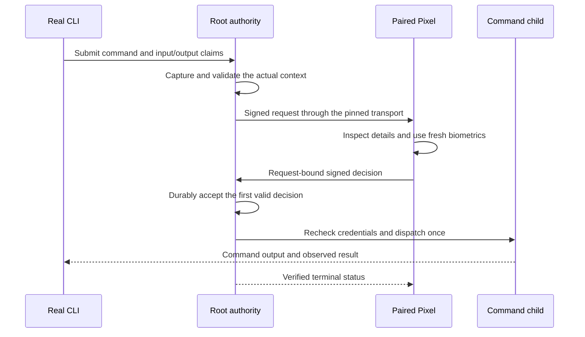

# First Mac–Pixel integration session

The app now includes account setup, service activation, pairing and a foreground command inbox.
Installed behavior remains untested. This candidate is not ready for Root command approval.

[Issue #298](https://github.com/rock3r/remozio/issues/298) is a known blocker.
The Mac reports 24 directory groups for root. The command launcher accepts at most 16.
Run the native credential experiment first. Fix and review the production contract before the durable installation and Root execution tests.
Do not truncate groups or omit this gate to obtain a successful demo.

## What exists

| Surface | Connected in source | Still needs evidence or integration |
| --- | --- | --- |
| Mac app | Protected setup controls, target grants, service accounts, runtime files, Start/Restore and pairing | Native installation, hardware keys, service credentials, live IPC and network access |
| Android app | Hardware enrollment, code comparison, biometric confirmation, saved Macs and foreground command actions | Actual Pixel enrollment and approval with this installed Mac |
| Command path | Real CLI, capture, authority, journal, transport and executor | Root credentials in #298 and the complete installed path |
| Push | Sender and notification components | Credentials, application integration and real background delivery |
| Other product work | Adapter, relay, ADB and updater components or experiments | Their remaining integration and end-to-end tests |

Green component tests do not establish an installed approval flow.
A foreground LAN test does not establish push, relay operation or background recovery.
The complete approved product scope remains open.

## Prepare before the user returns

- Use an Apple Silicon Mac and a Pixel with Android 17 or later.
- Record the actual OS versions. A macOS 27 result does not prove macOS 26 behavior.
- Choose artifacts from the same reviewed source. Retain their hashes and signing mode.
- Build the Mac candidate through the [initial package procedure](../macos-initial-package.md).
- Build the debug APK through the [Android guide](../../android/README.md). Preserve its existing signing identity when updating.
- Run the repository gate before selecting artifacts. Do not install a package or contact the phone as part of that gate.

The developer candidate contains a Developer ID signed app inside an unsigned local package.
It has no notarization result. Archive checks do not prove native installation.
All persistent executables remain inside the app.

## Stage 1: standalone native credentials

### 1. Resolve the credential gate

Follow the [target-group experiment](macos-command-groups.md).
Ordinary inspection and owned-child controls are prepared. The privileged credential controls remain unrun.

With the user present, prepare a protected temporary copy of the fixed probe and obtain native administrator consent.
The probe uses isolated children and a disposable file. It does not install a service or execute an arbitrary target command.
Compare full group assignment, the static subset and native directory membership through actual file access.
Record failures as results. Do not infer effective access from a group count.

Use that evidence to implement and review the production credential fix.
The standalone experiment needs no persistent Remozio installation.

## Stage 2: installation and pairing

First complete the credential fix and verify the intended update or recovery route.
The initial package supports fresh installation and same-build recovery. It refuses a different installed release.
Do not install an intermediate candidate that needs a known code fix, then assume a later package can replace it.
Do not erase the installation to bypass this protection.
Sparkle remains later product work; an initial package is not an updater.

### 1. Install and prepare this Mac

Use the [initial package](../macos-initial-package.md) and [account setup](../macos-account-preparation.md) procedures.

1. Run the local package with the user present. Validate protected placement and the Applications shortcut.
2. Open Remozio. Use its setup service control and complete the required macOS consent.
3. Choose **Set up command approvals…**. Select the intended target UIDs and accept the separate Remozio policy. `0` means root.
4. Choose **Prepare account…**. Verify hardware key creation and restoration without a software fallback.
5. Choose **Prepare service accounts…**. Verify the dedicated users, groups and protected file access.
6. Accept the private-file TLS disclosure, then choose **Prepare runtime files…**.
7. Choose **Start services…**. Check the authenticated authority connection in the main window separately from saved registration progress.

Validate actual service credentials and signed IPC admission before relying on these services.
[Issue #286](https://github.com/rock3r/remozio/issues/286) tracks the installed boundary checks.
A matching plist or saved registration marker does not prove service health.

If installation or setup fails, retain the existing state and read its progress.
A same-build retry must preserve identity. Do not erase protected files or recreate keys to make the test pass.
**Restore services…** reconciles matching jobs; it does not replace a conflicting registration.

### 2. Pair the Pixel

Keep both devices on the same LAN. Keep the Android app open for this initial path.

1. On the Mac, choose **Pair a phone…**.
2. On Android, choose **Pair a Mac**. Scan or paste the Mac invitation and grant local network access.
3. Select the requesting phone on the Mac. Compare the complete code on both screens.
4. Confirm matching codes on both devices and complete the phone's biometric prompt.
5. Require completion on both devices. A Mac-side save alone does not prove that the phone received its receipt.

Preserve an incomplete record after a lost reply. Receipt recovery UI remains unfinished in this candidate.
Do not discard its keys or silently start another enrollment.

## Stage 3: first complete approval

Start this stage only after the native gates and the production credential fix pass.
Use the actual reviewed app, not a synthetic harness or software production keys.



Set **Away** from the Mac menu while testing.
Active Mac use otherwise suppresses phone routing. Open this Mac's command inbox on the phone.

From an ordinary Mac terminal, run the embedded CLI with a disposable command:

```sh
"/Library/Application Support/Remozio/Applications/Remozio.app/Contents/Helpers/remozio" run --pipes --uid 0 -- /usr/bin/id
```

Inspect the exact command and target on the phone, then approve with fresh biometrics.
Check the caller result, the verified phone result and the durable audit evidence.
Also test explicit decline and configured authorization expiry. Neither may dispatch the command.

Then test connection loss, competing phone decisions, stale requests, revoked enrollment and restart recovery.
Keep Unknown outcomes distinct from success, denial and confirmed expiry.
Do not automatically retry an uncertain external action.

## Timing and later checks

The first Mac session can start with the standalone credential experiment.
Its results determine the production fix, which needs a separate implementation and review cycle.
Reserve 60–90 minutes for installation and pairing after that fix and the update/recovery gate pass.
Do not promise Root approval in the current candidate or a calendar date before that evidence.

Keep lock, logout, restart, Chrome Remote Desktop and Screen Sharing checks last, as requested.
Do not change 1Password, Little Snitch or PAM during these initial tests.
Background push, remote relay, ADB, prompt adapters and updater integration remain required later work.

## Record the evidence

Keep raw results under the ignored `experiment-results/` directory.
Commit only a reviewed, sanitized record under `docs/experiments/evidence/`.
Record the commit, artifact hashes, OS versions, starting state, user action, observed result, cleanup and limitations.

Exclude passwords, private keys, provider tokens, device serials, network addresses and real approval payloads.
Record public fingerprints only when needed for continuity.
A timeout remains Unknown unless an independent observation establishes the outcome.

Whole-Mac backup rollback and the final pathname execution race remain the user's accepted limits.
They do not waive ordinary crash recovery, signature checks, replay protection or target credential validation.
See the [accepted decisions](../design-decisions.md).
