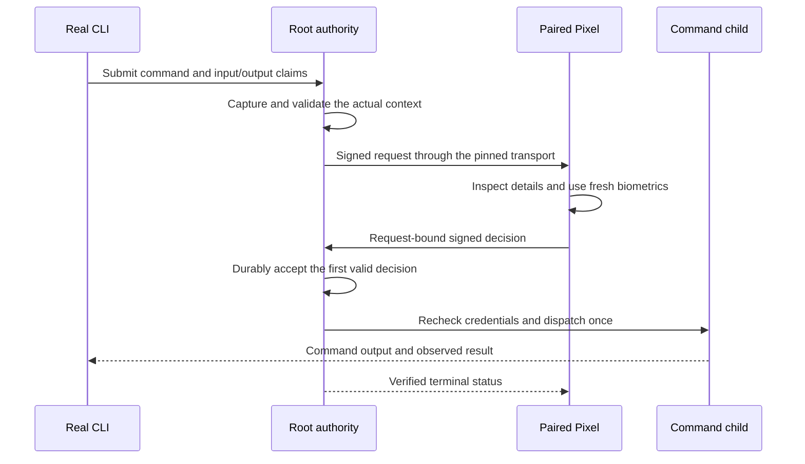

# First Mac–Pixel integration session

The app includes account setup, service activation, pairing and a foreground command inbox.
The native credential gate passed on macOS 26.6.2.
The first native installation on macOS 27.0.1 failed before bootstrap because of an OS access label.
The [metadata fix](macos-installed-access-metadata.md) passed review, CI and actual installed-tree inspection.
A second native package attempt failed before bootstrap. Direct supervised bootstrap then completed with the same signed helper.
The installed app cannot launch because its enclosing signature claims restricted entitlements without a profile.
A [disposable signing control](macos-release-signing.md#native-launch-control-16-october-2026) opened the app without those claims.
The initialized machine still pins the former signature. A verified transition remains required.
Installed service behavior and production Root approval remain unproven.

[Issue #298](https://github.com/rock3r/remozio/issues/298) records the six passing actual-child controls.
The [production credential path](../macos-native-account-credentials.md) uses native account initialization and retains the complete captured identity.
Installed account/code/IPC checks and the complete Mac–Pixel flow remain separate gates.

## What exists

| Surface | Connected in source | Still needs evidence or integration |
| --- | --- | --- |
| Mac app | Protected setup controls, target grants, service accounts, runtime files, Start/Restore and pairing | Native installation, hardware keys, service credentials, live IPC and network access |
| Android app | Hardware enrollment, code comparison, biometric confirmation, saved Macs and foreground command actions | Actual Pixel enrollment and approval with this installed Mac |
| Command path | Real CLI, capture, authority, journal, transport and executor | Installed service admission and the complete approval path |
| Push | Sender and notification components | Credentials, application integration and real background delivery |
| Other product work | Adapter, relay, ADB and updater components or experiments | Their remaining integration and end-to-end tests |

Green component tests do not establish an installed approval flow.
A foreground LAN test does not establish push, relay operation or background recovery.
The complete approved product scope remains open.

## Prepare before the user returns

- Use an Apple Silicon Mac and a Pixel with Android 17 or later.
- Record the actual OS versions. A macOS 27 result does not prove macOS 26 behavior.
- Choose artifacts from the same reviewed source. Retain their hashes and signing mode.
- Build the Mac candidate through the [initial package procedure](../macos-initial-package.md).
- Build the debug APK through the [Android guide](../../android/README.md). Preserve its existing signing identity when updating.
- Run the repository gate before selecting artifacts. Do not install a package or contact the phone as part of that gate.

The developer candidate contains a Developer ID signed app inside an unsigned local package.
It has no notarization result. Archive checks do not prove native installation.
All persistent executables remain inside the app.

## Stage 1: standalone native credentials

### 1. Resolve the credential gate

Follow the [target-group experiment](macos-command-groups.md).
The privileged API controls completed on macOS 27.0.1 with native administrator consent.
Full static assignment failed. The bounded subset lost extra-group file access; native initialization preserved access.
Root initialization also succeeded. Parent credentials stayed unchanged and all disposable fixtures were removed.

The [actual-child experiment](macos-production-child.md) passed on hosted macOS 26.6.2 at source `2bbda9c`.
It measured the real monitor and child with disposable targets. All six privileged controls passed.
Parent credentials stayed unchanged, owned cleanup was confirmed and the fixture was removed.
The earlier API probe and group counts alone do not establish this result.

## Stage 2: installation and pairing

The credential fix and actual-child gate passed.
The original uninitialized app was archived intact through a verified same-parent move.
The corrected app passed installed-tree and Root inspection, but its native package postinstall still failed.
Direct supervised bootstrap created the machine files. The machine now has retained identity and release pins.

| Current boundary | Result |
| --- | --- |
| Native package installation | Failed; [#402](https://github.com/rock3r/remozio/issues/402) remains open |
| Direct signed-helper bootstrap | Completed; follow-up inspection returned `retained` |
| Installed app launch | Refused; [#404](https://github.com/rock3r/remozio/issues/404) tracks profileless signing |
| Disposable corrected signature | Main window opened; no setup action ran |
| Applications shortcut | Root-only mode; [#405](https://github.com/rock3r/remozio/issues/405) tracks user access |
| Account setup, services and Pixel pairing | Not started |

The shortcut producer fix passes its ordinary-owner tests, including the restrictive umask control.
This does not prove that the installed shortcut is readable. The installed entry remains unchanged.

Do not retry the failed package, strip its OS label or overwrite the initialized installation.
Preserve both signed apps and all machine state. Prepare a verified transition before further installed setup.
The initial package supports fresh installation and same-build recovery. It refuses a different installed release.
Do not install an intermediate candidate that needs a known code fix, then assume a later package can replace it.
Do not erase the installation to bypass this protection.
Sparkle remains later product work; an initial package is not an updater.

### 1. Install and prepare this Mac

Use the [initial package](../macos-initial-package.md) and [account setup](../macos-account-preparation.md) procedures.

1. Run the local package with the user present. Validate protected placement and the Applications shortcut.
2. Open Remozio. Use its setup service control and complete the required macOS consent.
3. Choose **Set up command approvals…**. Select the intended target UIDs and accept the separate Remozio policy. `0` means root.
4. Choose **Prepare account…**. Verify hardware key creation and restoration without a software fallback.
5. Choose **Prepare service accounts…**. Verify the dedicated users, groups and protected file access.
6. Accept the private-file TLS disclosure, then choose **Prepare runtime files…**.
7. Choose **Start services…**. Check the authenticated authority connection in the main window separately from saved registration progress.

Validate actual service credentials and signed IPC admission before relying on these services.
[Issue #286](https://github.com/rock3r/remozio/issues/286) tracks the installed boundary checks.
A matching plist or saved registration marker does not prove service health.

If installation or setup fails, retain the existing state and read its progress.
A same-build retry must preserve identity. Do not erase protected files or recreate keys to make the test pass.
**Restore services…** reconciles matching jobs; it does not replace a conflicting registration.

### 2. Pair the Pixel

Keep both devices on the same LAN. Keep the Android app open for this initial path.

1. On the Mac, choose **Pair a phone…**.
2. On Android, choose **Pair a Mac**. Scan or paste the Mac invitation and grant local network access.
3. Select the requesting phone on the Mac. Compare the complete code on both screens.
4. Confirm matching codes on both devices and complete the phone's biometric prompt.
5. Require completion on both devices. A Mac-side save alone does not prove that the phone received its receipt.

Closing a fresh phone setup before a proof submission removes only its unsubmitted local preparation and unused keys.
The biometric prompt can be retried while that setup remains open. Close can retry a failed cleanup.
Preserve an incomplete record after any proof submission attempt or process restart.
For an incomplete record, choose **Check pairing** to query the Mac with its retained transport identity.
A verified committed receipt completes that preparation without another biometric proof.
An unavailable reply remains Unknown. Keep its keys and record; do not silently start another enrollment.
This path is connected in source through [PR #388](https://github.com/rock3r/remozio/pull/388); actual Pixel recovery remains untested.

## Stage 3: first complete approval

Start this stage only after the native gates and the production credential fix pass.
Use the actual reviewed app, not a synthetic harness or software production keys.



Set **Away** from the Mac menu while testing.
Active Mac use otherwise suppresses phone routing. Open this Mac's command inbox on the phone.

From an ordinary Mac terminal, run the embedded CLI with a disposable command:

```sh
"/Library/Application Support/Remozio/Applications/Remozio.app/Contents/Helpers/remozio" run --pipes --uid 0 -- /usr/bin/id < /dev/null
```

Inspect the exact command and target on the phone, then approve with fresh biometrics.
Check the caller result, the verified phone result and the durable audit evidence.
Also test explicit decline and configured authorization expiry. Neither may dispatch the command.

Then test connection loss, competing phone decisions, stale requests, revoked enrollment and restart recovery.
Keep Unknown outcomes distinct from success, denial and confirmed expiry.
Do not automatically retry an uncertain external action.

## Timing and later checks

The standalone credential experiment is complete.
The production fix passed review, all five CI checks and the actual privileged child measurement.
The first session found the native metadata blocker in #402.
The signing fix, verified machine transition and remaining native installation controls must pass before installed setup can continue.
After that gate, reserve 60–90 minutes for installed boundaries, pairing and approval/decline/expiry.
A native failure can require further code work. This allowance does not promise a successful complete flow.
The [hosted package experiment](macos-native-package.md) can reduce installer uncertainty while the user is away.
It does not replace administrator consent, service checks or Pixel evidence.

Keep lock, logout, restart, Chrome Remote Desktop and Screen Sharing checks last, as requested.
Do not change 1Password, Little Snitch or PAM during these initial tests.
Background push, remote relay, ADB, prompt adapters and updater integration remain required later work.

## Record the evidence

Keep raw results under the ignored `experiment-results/` directory.
Commit only a reviewed, sanitized record under `docs/experiments/evidence/`.
Record the commit, artifact hashes, OS versions, starting state, user action, observed result, cleanup and limitations.

Exclude passwords, private keys, provider tokens, device serials, network addresses and real approval payloads.
Record public fingerprints only when needed for continuity.
A timeout remains Unknown unless an independent observation establishes the outcome.

Whole-Mac backup rollback and the final pathname execution race remain the user's accepted limits.
They do not waive ordinary crash recovery, signature checks, replay protection or target credential validation.
See the [accepted decisions](../design-decisions.md).
