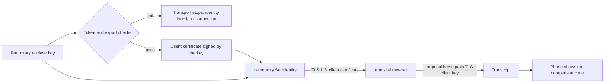

# iOS Secure Enclave TLS experiment

On 10 November 2026, TestFlight build 4 on a physical iPhone completed a client-authenticated TLS 1.3 handshake with
`remozio-linux-pair`, and the peer accepted the phone's TLS key as the transport key of the setup proposal. In that
build, a device can present only a temporary Secure Enclave P-256 key that passed a token check and an export check
(see [custody](#how-custody-is-established)). The key signed the phone's client certificate through
`Certificate.PrivateKey(SecKey)` (swift-certificates 1.21.0), `SecIdentityCreate` paired it with that certificate in
memory, and Network.framework signed the handshake with it.

This is the device gate of the B4 key custody plan (#436). The [Mac result](macos-enclave-tls.md) is not evidence for
iOS: before this run, no iPhone had used an enclave key in a TLS identity.

## Setup

| Part | Value |
| --- | --- |
| Phone | iPhone 16 Pro (iPhone17,1), iOS 27.2 (24B119) |
| App | TestFlight build 4 (version 0.1.0) of `dev.sebastiano.remozio.ios`, built from `main` at 7edb8fb8, which includes #663. The installed build number was read from the device before the result was accepted. |
| Computer | `remozio-linux-pair` from `experiments/linux-pairing-peer` at 7edb8fb8, release build on Ubuntu, with its own software keys |
| Route | A private overlay network. The address was typed in Add computer, and the peer ran with `--no-advertise`. No Bonjour discovery. |

## What the app does on a device

`PairingTransportKey.make()` in `ios/Remozio/PairingNetwork.swift` creates the transport key for each Test connection:

- `kSecAttrTokenIDSecureEnclave` and `kSecAttrIsPermanent: false`, with an access control object made from
  `.privateKeyUsage` and `kSecAttrAccessibleAfterFirstUnlockThisDeviceOnly`. These are the attributes of the Mac
  `EnclaveTLSProbe`, without its authentication context: `.privateKeyUsage` has no user-authentication constraint.
  The key is never stored, and this run does not show whether the requested accessibility has any effect on it.
- After creation, the key must carry the Secure Enclave token attribute, and `SecKeyCopyExternalRepresentation` must
  refuse to export it. A failed check is a failed key.
- The simulator branch, which uses a software key, is chosen at compile time. A device build has no code path to a
  software transport key.
- With a failed key, the transport stops with `identity failed` before discovery or any connection. The proposal is
  sent only after the transport opens, so a placeholder key never leaves the phone.

## Result

| Check | Result |
| --- | --- |
| Installed build | 4, read from the device |
| Peer | Printed `Compare on the phone.`, which it prints only after it has compared the proposal's transport key with the TLS client key and sent the transcript |
| Phone | "The computer answered" with a 20-character comparison code |
| Pairing | None. Test connection sends no proof, and nobody typed the code on the computer, so the peer enrolled nothing |

## How custody is established

Custody is inferred from the installed build and its code path. It was not observed on the device. The peer cannot
tell an enclave key from a software key: it sees a P-256 public key and a valid signature. In build 4 on a device, the
only key that can sign the client certificate is one that passed the token and export checks. Any other outcome stops
before a connection, so the peer would never have sent a transcript.

A run a few minutes earlier came from build 3 (`main` at 1699eb23, before #663) by mistake. Build 3 uses a software
transport key, and it reached the same screen. That run does not count. It shows that the screen alone says nothing
about custody; the installed build number decides which code path ran.

The unified log line `transport key: in the Secure Enclave, export refused` (subsystem `dev.remozio.pairing`) would show
the checks directly. It was not collected in this run. A repeat should collect it.

## Not tested

- Permanent keys, and key or certificate lifetime over app restarts.
- A handshake while the phone is locked, or after a restart before the first unlock.
- The Face ID signature and the decision key. Test connection sends no proof.
- A complete pairing, Bonjour discovery on iOS, and a Mac as the peer.
- The peer's own key custody. `remozio-linux-pair` uses software keys.

## Repeat

1. Install a TestFlight build from `main` that includes #663, and confirm its build number on the device.
2. On the computer, in `experiments/linux-pairing-peer`, run
   `swift build -c release --product remozio-linux-pair`, then `init` and `invite`. Start
   `pair --listen <IPv4>:<port> --no-advertise` with standard input held open, and type nothing.
3. On the phone, paste the invitation, type the address and tap Test connection.

Pass: the device reports a build that includes #663, the phone shows the comparison code, and the peer printed
`Compare on the phone.` The log line above is the direct signal of the enclave checks. On a failure the screen shows
only Failed. The unified log for subsystem `dev.remozio.pairing` names the failed stage and the error code, with no key
data. A network failure also logs the system's error text as public. This run did not check whether that text can
contain an address; a repeat that collects the enclave line should check it.
