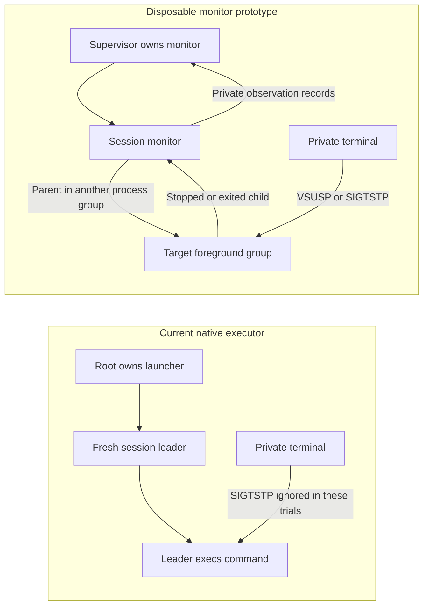

# Command job-control experiment

The current private-terminal leader ignored `SIGTSTP` in ten native trials. A separate session monitor preserved normal stop and resume behavior.

The [recorded evidence](evidence/2026-10-09-command-job-control.json) contains 50 trials. The runtime was macOS 27.0.1 on Apple Silicon.
The deployment target was macOS 26. The same experiment also passed on macOS 26.6.2 in CI, as recorded below.
Production monitor integration and privileged execution remain untested on macOS 26.

## Current leader and candidate monitor



The recorded native case links `CommandProcess.c`, `CommandPTY.c`, and the launch decoder from PR 246. It uses the existing synthetic launcher.
The stopped child remains owned and unreaped. `SIGSTOP` stops it; `SIGCONT` resumes it; the actual exit status is 7.
That revision exposed neither stopped nor continued states. PR 249 adds raw native observations; it does not implement production job control.

The candidate keeps the session leader alive in a separate process group. The target remains its child and becomes the terminal's foreground group.
The monitor observes the child through `waitpid`, including stopped and continued states. The target closes private descriptors before exec.

## Measured cases

| Case | Trials | Result |
| --- | --- | --- |
| Current native leader | 10 | Default `SIGTSTP` does not stop it; explicit stop, resume, and actual exit remain observable |
| Monitor and direct suspend signal | 10 | Target stops; monitor keeps running; resumed target exits 7 |
| Monitor and terminal suspend character | 10 | The terminal sends `SIGTSTP`; target stops and resumes; exact output and exit 7 remain intact |
| Cancellation while stopped | 10 | Target exits through `SIGKILL`; monitor reports its actual wait status and exits cleanly |
| Missing executable | 10 | No exec event; private failure reports `ENOENT`; actual target exit is 127 |

Both the monitor and external supervisor register kernel exec and exit observations before release.
The external supervisor sees target exec only in successful execution cases. It sees target exit in all four monitor cases.
The monitor remains the target's exclusive wait owner. External kernel events do not grant target process ownership.

## Stop and resume sequence

```mermaid
sequenceDiagram
    participant S as Disposable supervisor
    participant M as Session monitor
    participant T as Target foreground group
    participant P as Private terminal
    M->>T: Fork target; hold exec gate
    M->>P: Select target foreground group
    M->>S: Report prepared target
    S->>T: Register kernel exec and exit events
    S->>M: Release fixture gate once
    M->>T: Release target exec
    T->>S: Kernel exec event
    S->>P: Write terminal suspend character
    P->>T: Deliver SIGTSTP
    T->>M: Actual stopped child status
    M->>S: Report stopped state
    S->>P: Deliver SIGCONT
    P->>T: Resume foreground group
    T->>M: Actual exit status 7
    M->>S: Report terminal status; exit
    S->>M: Reap owned monitor
```

## Reproduce

Run `python3 scripts/run-macos-job-control-experiment.py` without elevation on an Apple Silicon Mac.
The runner compiles disposable fixtures, creates private terminals, verifies 60 observations, and prints sanitized JSON.
`./scripts/check.sh` includes this runner on macOS. The sources remain under `experiments/command-job-control`; packaging does not embed them.

The runner rejects changed observations. It records source hashes and host versions. Its temporary paths and target arguments stay out of evidence.
Fixture loop deadlines bound experiments only. They define no product execution limit.

Failed subprocesses retain the case, trial, exit status or timeout, and bounded excerpts from both output streams.
Partial timeout output is decoded safely. These diagnostics add no retry and change no fixture deadline.
The native PTY backpressure test also reports its progress counters when a transfer operation throws.
It performs no extra journal read while reporting the failure. The earlier intermittent causes remain unproven.

## Fixture group setup

Failure-only diagnostics for [issue 309](https://github.com/rock3r/remozio/issues/309) captured a target `setpgid()` failure with `EPERM` before exec.
Both the monitor and target previously configured the target group concurrently.
The monitor now owns group selection while the target waits at its private exec gate.
After release, the target verifies that its group equals its PID before exec.
The monitor still selects the foreground group before reporting the target to the external supervisor.
All signal, kernel-event, output and wait assertions remain required. No deadline or cleanup rule changed.
This removes the observed redundant-call failure path. It does not prove the cause of every earlier intermittent failure.

## Exec-error completion race

The prototype could read an empty exec-error pipe, then reap a target that wrote its error between those observations.
It could publish terminal status and close the unread pipe without reporting `ENOENT`.
The [issue 309 diagnosis](https://github.com/rock3r/remozio/issues/309#issuecomment-6111675126) reproduced that ordering in temporary fixtures.

After reaping, the prototype now reconciles the private error pipe before reporting terminal status.
It reports a late error first, preserves an already reported error, and accepts normal EOF.
The same reader checks errors before waiting and after reaping. A partial record in either path blocks the terminal report.
Interrupted reads retry without changing a fixture deadline.

The completion probe holds its child at a private gate while the first nonblocking error read proves the pipe is empty.
It then releases and reaps the child before calling the prototype's actual completion function.
Ten trials check late error ordering, no duplicate error, normal EOF, and partial-record rejection in both paths.
For the pre-wait case, a child acknowledgement proves its partial record is readable before the first wait.
A compiled legacy terminal-only control must fail the first case. No timing delay creates this regression.

This repair changes only the disposable prototype. It adds no experiment retry and changes no product monitor, service, or execution policy.
The historical 50-trial evidence remains evidence for its recorded source revision.

## Required integration

This result supports a monitor design. It does not establish production job control.

- Preserve the existing durable dispatch checkpoint and one release attempt. A stop or reconnect must never repeat execution.
- Verify and protect the installed monitor. Bind its private status channel to the original execution owner; target output cannot become control data.
- Register target kernel events before release. Preserve actual target exit status independently of the monitor's exit status.
- Give target cancellation to its exclusive wait owner. Never signal a target PID after reaping or ownership loss.
- Negotiate stopped and continued events in the frontend channel. Restore the caller terminal before suspension and capture fresh settings after foreground resume.
- Preserve separate redirected streams and pipe controls. A PTY must not silently merge redirected stderr or remove signal forwarding.
- Verify nested foreground jobs, monitor crashes, caller detachment, protected installation, and cross-user execution.

The [current native monitor and nested Bash experiment](macos-nested-shell.md) adds 30 private-terminal trials.
The installed service, production elevation, real CLI, user-terminal restoration and physical terminal checks remain gates.
No user terminal, firewall rule, device setting, or installed service changed during these experiments.

The same 50-trial experiment also passed on an Apple Silicon CI host with macOS 26.6.2 and SDK 26.5.
The [completed Mac job](https://github.com/rock3r/remozio/actions/runs/37876164698/job/113650441702) records the actual runtime and source hashes.
That result applies to PR 246, commit `ed4dad31e89a9dc1951c5b10d5cf1224f9a570b4`. It does not prove privileged or physical behavior.
