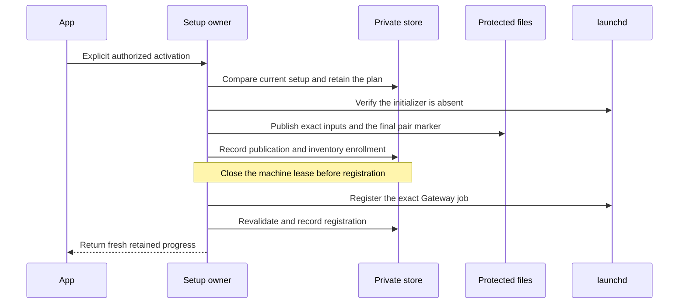

# Prepare and register the Gateway runtime

The authenticated setup channel can retain a Gateway activation plan and resume its protected stages. The plan binds the completed journal intent, original foreground runtime, public role records, service configuration and exact job manifest.

The owner reserves one asynchronous operation before releasing its first machine writer. Ordinary setup reads and mutations cannot borrow the machine while that reservation is active. This preserves the admission guard from PR447 and extends it to Gateway activation. Cancellation keeps the reservation and release activity until admitted work settles.

The operation checks initializer absence before publication, registration and completion. Registration runs outside machine scopes. A lost registration reply is reconciled against the exact job identity. Historical markers never prove that a service is currently running or a phone is reachable.

The Setup interface advances to version7 with bounded activation messages and fresh progress comparisons. Existing setup methods retain their contracts. The manifest and private store both support preparation schemas1through10. Native peer authentication, administrator authorization and current release validation remain independent requirements.

## Validation and remaining integration

The staged admission methods match the current full draft. Nineteen related owner controls passed, including the new activation handoff and cancellation regression. Prior component checks cover activation plans, private stages, files, registration prerequisites, Root ownership and XPC transport shape.

The combined public candidate still needs its focused and full repository gates. The changed XPC experiment must also pass its live checks. Same-owner fixtures do not prove production Root identity, dedicated service accounts or administrator rights import.

This backend batch excludes visible app controls. The production setup factory must select the complete native family before the app exposes activation. Installed service checks and physical Mac-Pixel testing remain on the operator handoff.
