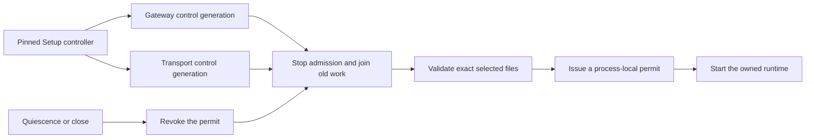

# Bind companion controls to the current service process

Gateway and Transport use distinct control bindings and message purposes.
Each binding includes the Mac, account, role and fresh process generation.
A request also binds the exact pause record, selected commit and fresh challenge.
A decoded message or pause record grants no native authority.

The owner tracks startup and cleanup separately. A cancellation cannot make unsettled work disappear.
Quiescence revokes admission before joining the current runtime.
A failed close retains its cleanup work. Later cleanup must join the same work.
Late startup or acceptance cannot restore a revoked permit.
A permit binds the current process, generation, exact configuration and selected commit.
A new process cannot reconstruct it from saved progress.

Native endpoints accept only pinned Setup code running as Root.
Clients verify the selected consumer code, dedicated service UID and expected generation.
Calls have deadlines and never retry uncertain mutations automatically.
Each listener closes admission and joins retired endpoints before releasing its scope.

Signed declarations advertise companion control version 1 for each consumer and Setup.
Root has no companion control version 1 capability. Its later recovery path uses a separate interface.
The pause record declares version 1 readers and Setup as its sole emitter.
Actual Debug and Release artifact checks compare declarations with compiled contracts.
The existing journal fixture becomes visible only to sibling tests; its behavior stays unchanged.

Codec, owned runtime and anonymous XPC controls verify these mechanisms.
They do not prove installed dedicated service admission or Developer ID identity.
Native runtime adapters, host metadata, fixed registration, restart recovery and app integration follow separately.
No installed services, production credentials, physical devices or frozen recovery artifacts are used for these checks.
