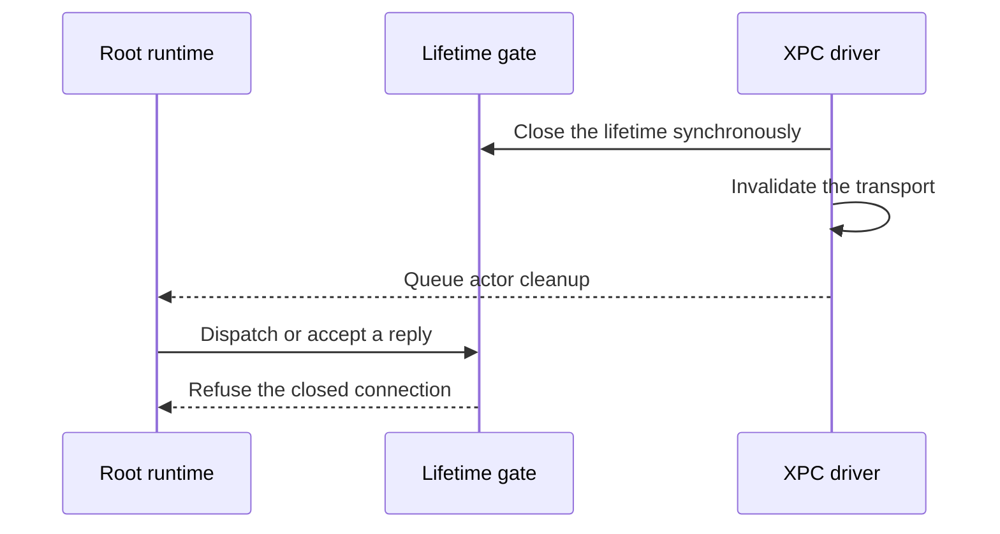

# Normal gateway connection lifetime

A lost Root control connection is terminal. Recovery creates a fresh channel and repeats its harmless version handshake.

The connection callback closes a shared lifetime and invalidates the driver before it queues actor cleanup. Dispatch and reply acceptance check the lifetime. Cancellation does the same. Only the first closer invalidates the driver.

The existing publisher recovery path handles the terminal result. Code and UID policies, protocol versions and signed recovery checks remain in force.

Two deterministic regressions reproduce hello or control dispatch after connection loss. They fail before the fix. The corrected component run passes 105 related tests. An existing shutdown check also verifies one driver cleanup.

These are injected-driver and owned journal checks. They do not prove native Root admission, dedicated service UID isolation or installed gateway recovery. The frozen interactive package is unchanged.

[The frozen gate evidence](evidence/2026-10-18-macos-gateway-control-lifetime.json) records 2620 passing core tests, 804 Kotlin/Android reports, assembly and lint.

[The frozen gate evidence](evidence/2026-10-18-macos-gateway-control-ownership.json) records 2621 passing core tests, 804 Kotlin/Android reports, assembly and lint.

[The frozen gate evidence](evidence/2026-10-18-macos-gateway-control-reply-ownership.json) records 2622 passing core tests, 804 Kotlin/Android reports, assembly and lint.
