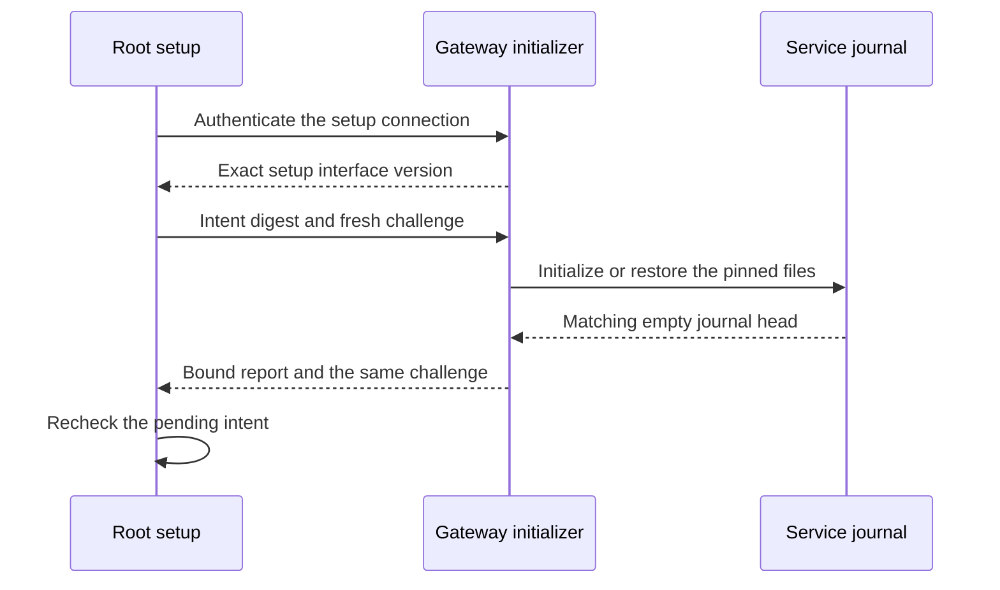

# Authenticate gateway journal initialization

A pending gateway setup uses a separate local XPC exchange.
The Root setup process proves its code identity to the gateway.
The Root client verifies the gateway code and dedicated UID before accepting its reply.

## Request and response

The local interface supports version 1. It is separate from the normal gateway endpoint.
The setup code entry must have the setup-controller role.
Every exported invocation rechecks the connection's kernel credentials.
A connection permits one initialization attempt. A shared budget bounds concurrent work.

The report binds the intent identifier and the canonical scope digest.
It reports whether this attempt initialized the empty journal or restored it.
The response also binds a fresh 32-byte client challenge.
The codecs reject unknown versions, unexpected fields, changed scope and oversized data.

Report bytes alone prove no authorization. The client must authenticate the live peer first.
The Root client checks the gateway code hash, Team ID, identifier and dedicated UID.
It validates the service account and pending setup before sends and before returning the report.
A timeout or connection loss closes the channel. Late replies cannot complete a different request.

## Storage and retries

The owned exchange tests use the actual initializer and SQLite stores.
A lost reply leaves the Root intent pending. A later attempt restores the same journal.
A replaced database cannot advance the Root completion marker.
The initializer accepts only the matching registration with an empty head.
A successful report does not prove current gateway health, provider delivery or normal activation.

## Scope and verification limits

This component adds the report, endpoint and client. It exposes no command-line initialization mode.
The native listener, temporary job and administrator endpoint remain later integration work.
It does not publish standalone intent files or enable push delivery.
Normal gateway startup still requires an existing journal.

The fixtures use one ordinary owner and disposable software keys.
They test sequencing, framing, cancellation and storage recovery.
They do not prove installed Root admission, dedicated UID isolation or native XPC peer admission.
The host runs macOS 27. The macOS 26 deployment target is not macOS 26 runtime evidence.
The frozen interactive package and recovery handoff remain unchanged.

[The component record](evidence/2026-10-18-macos-gateway-journal-exchange.json) covers source commit `e420430`.
The full local gate passed 2615 core tests and 804 Kotlin/Android reports.
Assembly and lint passed with no new lint issues. The record identifies the explicit native skip and the validation limits.

## Connection loss

The connection callback closes a shared lifetime and invalidates the driver before it schedules actor cleanup. Dispatch, reply handling and final acceptance check that lifetime. Cancellation also closes it before actor cleanup.

Three deterministic regressions first reproduced requests after loss or report acceptance after loss. They now pass with the complete 25-test exchange suite. They use injected drivers and do not prove native Root admission.

[The connection lifetime evidence](evidence/2026-10-18-macos-gateway-setup-lifetime.json) records the reviewed fix.
The revised full gate passed 2618 core tests and 804 Kotlin/Android reports, plus assembly and lint.

## Live native selector checks

The unprivileged XPC probe exports the actual setup protocol. It checks hello and both Data arguments, including empty and nil replies. Negative controls reject wrong client or server identifiers, wrong effective UIDs and a guard bound to another connection.

The probe uses disposable ad-hoc identifiers and synthetic bytes. It calls the real credential and invocation guards on native connections. Its identifier requirement is separate from its synthetic policy used for UID checks. This does not validate Developer ID chains, Root UID admission or dedicated service accounts.

The runner registers one temporary service in the current GUI domain. It removes that service and confirms its absence before success.

[The live native XPC evidence](evidence/2026-10-18-macos-gateway-setup-live-xpc.json) records all 62 passing controls and temporary-service cleanup.
The same frozen source passes the full local gate: 2618 core tests and 804 Kotlin/Android reports, plus assembly and lint.
