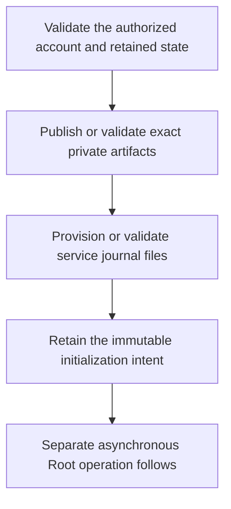

# Synchronous journal setup preparation

The authorized Root setup host prepares the exact private artifacts and journal files before opening the separate asynchronous initializer. This source layer performs no launch and exposes no administrator endpoint.

A pending retry requires the retained file identities. It cannot recreate missing storage. Completed preparation validates the current service identities, then returns historical progress without touching private files or acquiring the active journal writer.

Thirty-four affected preparation tests pass, including nine controller controls. Owned fixtures cover interrupted stages, changed host or service scope, stale expected state, pending-file loss and completed retries. Two new regressions produce five failures before the service validation fix. The ordinary native caller is refused before filesystem access.

Root ownership transfer, dedicated UID isolation and installed signing remain required supervised checks in issue286. The owner deferred administrator and physical-device tests. No service is installed. The frozen first-flow package is unchanged.
