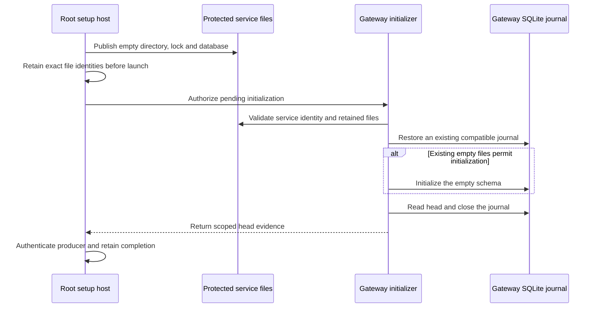

# Mac gateway journal preparation

The Root setup host prepares empty files for the gateway account.
The gateway process initializes SQLite under its dedicated identity.
Root never opens the service journal through SQLite.

The diagram includes later integration steps.
This component provides the file provisioner and initializer, without connecting a native launcher or protected completion transition.

## File publication

The Root entry checks the retained gateway account and fixed account paths.
It creates a private staging directory with an empty writer lock and database file.
Only newly created objects receive ownership or permission changes.
An exclusive rename publishes the directory as one unit.

| Object | Owner | Mode |
| --- | --- | --- |
| `Gateway/` | Gateway account | `0700` |
| `writer.lock` | Gateway account | `0600` |
| `gateway.sqlite` | Gateway account | `0600` |

Existing directories must contain both files with the expected metadata.
A missing file is not recreated. Existing permissions are not repaired.
An interrupted staging directory remains intact for diagnosis.
The setup transition must retain all three device and inode identities before launching initialization.

## Initialization and recovery

The native initializer requires the configured gateway identity and the retained file identities.
It first attempts to restore an existing compatible journal.
Explicit pending setup may initialize an empty store. An incompatible nonempty store is never reset.
The initializer closes SQLite before returning the journal head.
It starts no request listener and reads no provider or signing credential.

A completed setup transition must never grant initialization permission again.
Its retry should return historical progress without acquiring the active journal lock.
Normal gateway startup continues to require an existing journal.
The later setup controller must enforce these transition rules and authenticate the report producer.

## Validation boundary

Owned fixtures exercise actual file publication, writer locks and SQLite initialization.
They cover interrupted publication, missing or replaced files, unsafe metadata, incompatible stores and retained history.
The fixtures use one ordinary owner. They do not prove Root ownership transfer or isolation between service accounts.
Native launch, report authentication, installed coexistence and device delivery remain integration gates.

[The component record](evidence/2026-10-18-macos-gateway-journal-preparation.json) covers source commit `13b909d`.
The full local gate passed 2582 core tests and 804 Kotlin/Android reports.
Assembly and lint passed with no new lint issues. The record identifies the explicit native skip and the validation limits.
