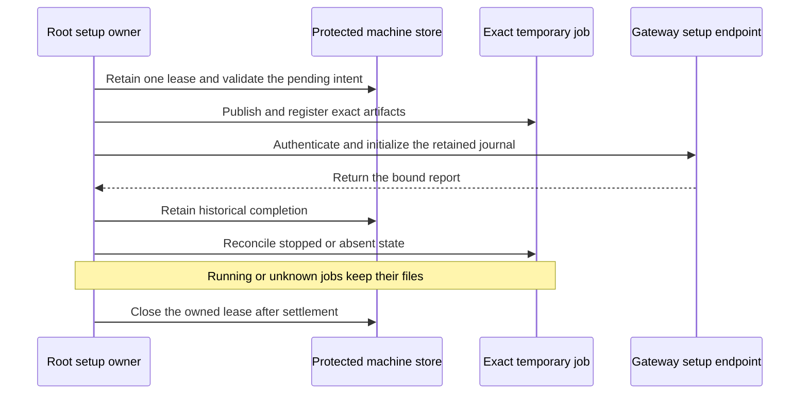

# Root journal setup owner

The Root operation owns one machine lease and release scope throughout the asynchronous gateway exchange. Each step revalidates the retained installation, account, intent and file scope. The administrator endpoint follows separately.

A lost reply keeps setup pending. A matching retry restores the same journal. Historical completion skips initialization and checks cleanup only. Root never opens the service SQLite journal.

The cleanup adapter validates the retained plist before removing a stopped job. It preserves files when job state is running or uncertain. Callback checks fail after scope closure or process replacement.

Thirty focused tests pass, including eight new controls. They use owned protected files and SQLite with injected job observations. These results do not establish system launchd behavior, Developer ID peer admission or dedicated UID isolation.

Installed validation remains required in [issue 286](https://github.com/rock3r/remozio/issues/286#issuecomment-6252183900). The owner deferred administrator and physical-device checks. This source layer does not activate a service or expose an app action. The frozen interactive package is unchanged.
