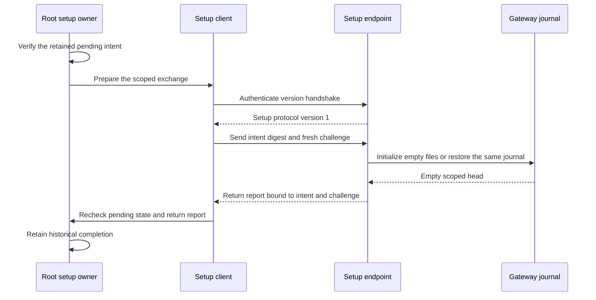

# Mac gateway journal setup exchange

Journal setup uses a separate local protocol between the Root setup helper and the gateway account.
It does not widen the normal gateway control endpoint or grant command authority.

## Current boundary

| Part | Current evidence |
| --- | --- |
| Setup endpoint and Root client | Compiled; owned invocation and driver fixtures |
| Journal operation | Actual owned SQLite creation and restoration |
| Combined exchange | In-process protocol with real owned SQLite and protected setup state |
| Native setup configuration and job | Compiled metadata models and exact manifest fixtures |
| Native listener and gateway entry mode | Compiled; six startup refusal controls |
| Root temporary job registration and cleanup | Pending integration |
| Dedicated UID, signed XPC peers and installed coexistence | Pending native runtime verification |

The software exchange covers successful setup, a lost reply and a replaced retained database.
A lost reply leaves Root setup pending. Its retry restores the same compatible journal.
Completed setup refuses another initialization request.
These fixtures do not establish native XPC routing or service account isolation.

## Separate identities

The setup endpoint pins the active `setupController` code under Root.
The client pins the active gateway code and dedicated gateway account.
The existing authority policy is not reused for setup.
Native configuration must come from protected release metadata and match the retained foreground scope.
The Root host must hold the release scope and validate its pending checkpoint before committing completion.

Protocol version 1 requires a harmless handshake before initialization.
Each endpoint admits one operation. Reports bind the intent identifier, scope digest and fresh client challenge.
Unknown versions, wrong bindings and malformed or oversized replies fail.
Timeout, cancellation and connection loss retire the exchange.
An active initializer retains its work budget until it finishes; disconnect does not imply that SQLite work has stopped.

## Native job contract

The temporary job uses the bundled gateway executable under its retained gateway user and group.
Its metadata fixes the `--journal-setup` mode and protected configuration path.
The draft connects this entry mode. Root setup does not launch it yet.
The label and Mach service include the account and intent scope.
`RunAtLoad` and `KeepAlive` are false. A demand start must expose only the authenticated setup listener.
Starting the process must never initialize SQLite before an authenticated setup request.

Public setup metadata contains code pins and retained scope, without provider credentials or private signing keys.
The native launcher must verify the signed release and reconcile only its exact temporary job.
It must observe stopped work before cleanup or a replacement launch.
A loaded job observation alone does not prove immutable settings, code identity or current health.

The native host must verify compatible components before the explicit schema 9 transition.
Older binaries do not gain support for schema 9.
The foreground runtime, pairings and frozen interactive package remain outside these draft changes.

The direct `--prepare-journal` prototype is retired and remains sealed as historical experiment evidence.
The current entry mode opens only the authenticated setup listener. Startup does not grant initialization permission.
The focused suite passed 44 fixtures, including public metadata rejection and active-work drain checks.
The compiled gateway passed six refusal controls with unchanged stdin, empty stdout and no created files.
These results do not prove dedicated UID admission or signed peer authentication at runtime.

## Temporary job ownership

The same PR includes the temporary service, its protected artifacts and its launchd lifecycle. These parts form one initializer feature. The Root setup operation and app API follow separately.

```mermaid
flowchart LR
  Pending[Retained pending intent] --> Files[Publish exact configuration and job]
  Files --> Register[Root registers the temporary job]
  Register --> Gateway[Gateway runs under its dedicated UID]
  Gateway --> Exchange[Authenticate the setup exchange]
  Exchange --> Stop[Wait for the exact job to stop]
  Stop --> Absent[Confirm the job is absent]
  Absent --> Remove[Remove only its matching job file]
```

The job uses `RunAtLoad=false` and `KeepAlive=false`. Ordinary gateway startup does not initialize a journal.

Registration accepts only the exact expected path, arguments, UID and Mach service. Cleanup does not stop a running or unknown job. It removes the matching plist only after absence checks. Journal files and credentials remain intact.

An unused prototype file case is removed. This PR does not add a standalone intent file or direct initialization CLI.

## Remaining native checks

Owned fixtures do not prove the system launchd format, Root admission, dedicated UID isolation or Developer ID peer validation. The supervised installation session must check these paths before runtime readiness is claimed.
