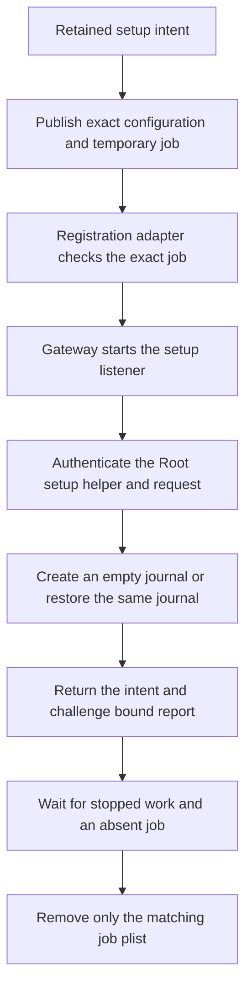
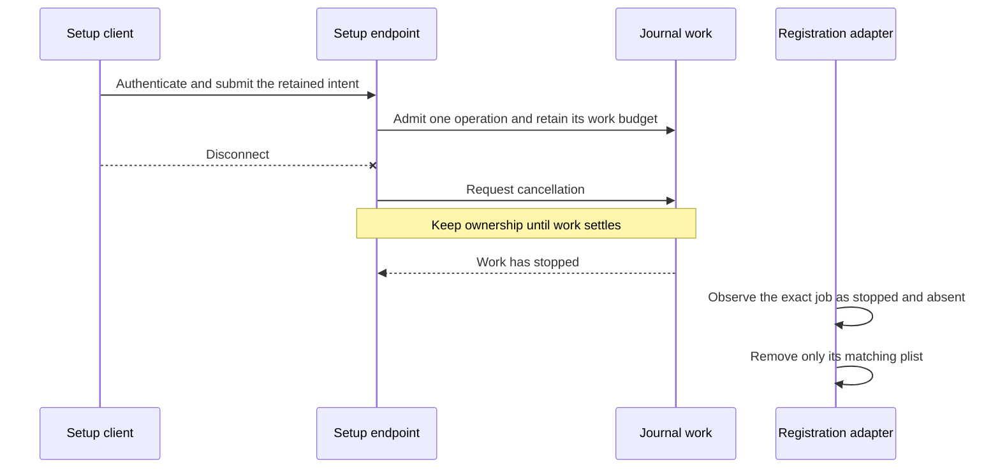

# Mac gateway journal initializer

The bundled gateway can host a temporary journal setup endpoint. Its configuration, job identity and cleanup belong to one retained setup intent. The Root operation and app action follow separately.

This flow describes the adapters and their intended composition. The Root setup owner does not orchestrate it yet. Owned fixtures do not establish system launchd admission.

## A separate endpoint

The temporary mode uses `--journal-setup`. Ordinary gateway startup does not initialize SQLite. The retired direct initialization CLI remains unavailable.

The job fixes the bundled executable, configuration path, dedicated user and group, and scoped Mach service. Its label includes the account and intent scope. `RunAtLoad` and `KeepAlive` are false.

The setup endpoint pins the active Root setup helper. The client pins the active gateway component and its dedicated account. Version 1 requires a handshake before initialization. Each connection admits one operation.

Reports bind the retained intent, scope digest and fresh client challenge. Unknown versions, wrong bindings and oversized or malformed replies fail. Public setup metadata contains no provider credential or private signing key.

## Work must settle before cleanup

A connection closing does not prove that SQLite work has stopped. The service retains admitted work until settlement. Cleanup refuses a running or uncertain job.

| Observation | Required behavior |
| --- | --- |
| Initialization succeeds | Return an exact scoped report; completion still needs the Root owner. |
| The reply is lost | Leave setup pending; restore the same compatible journal on a matching retry. |
| The retained journal is replaced | Refuse initialization or completion. |
| The job is running or unknown | Preserve its files and refuse cleanup. |
| The exact job is absent | Remove only its matching plist; preserve journal files and credentials. |
| Signed or protected scope changes | Refuse the operation. |

The native host must verify compatible components before selecting the explicit schema 9 transition. Older binaries do not gain schema 9 support through parsing metadata.

## Evidence boundary

The frozen gate below records this combined source revision. It covers the configuration and job models, work ownership, protected publication, registration adapters and cleanup fixtures.

The fixtures use owned files and injected lifecycle observations. They do not prove Root admission, dedicated UID isolation, Developer ID peer authentication or the system launchd job format.

The remaining integration connects the Root setup owner and app API. The supervised installation session must then check native service behavior and coexistence. No service is installed by these checks, and no physical phone is used.

[The frozen gate evidence](evidence/2026-10-18-macos-gateway-native-initializer.json) records 2651 passing core tests, 804 Kotlin/Android reports, assembly and lint.
