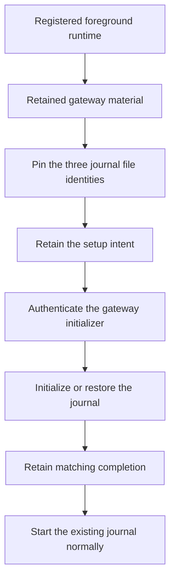

# Retain gateway journal setup progress

The machine store retains one gateway setup intent for each enrolled account.
A retry uses the same files and registration after a lost reply or a process restart.
Completion records past initialization. It makes no claim about current service health.

## Setup flow

This component implements the retained intent and completion state.
The authenticated initializer and native launcher require later components.
It does not expose a new administrator operation or activate push delivery.

## Retained scope

The intent binds the account, gateway material, service configuration and three file identities.
Its canonical digest covers all fields. The record contains no provider credential or private key.
The configuration must match the registered foreground runtime and current installation inventory.
The directory, lock file and database must have different inode numbers on the same device.

The machine store supports schema versions 1 through 9.
Reading an older store does not migrate it.
The first explicit intent transaction adds the bounded setup table and advances version 8 to version 9.
The table permits at most 64 accounts. Indexed fields must match their canonical records.
A failed transaction does not retain a partial migration.

An existing account intent is immutable. Repeating the exact request is harmless.
An account with a gateway already declared in the inventory cannot acquire a new initialization intent.
Completion requires the retained registration and an empty journal head.
A native caller must authenticate the initializer before it supplies that evidence.

## Retry behavior

| Retained state | Retry behavior |
| --- | --- |
| No intent | Creation requires an explicit, authorized setup operation. |
| Pending intent | Validate the original files, then initialize or restore the same journal. |
| Initialized | Return historical completion without inspecting or opening service storage. |
| Missing or replaced pending file | Refuse the operation. Do not regenerate storage. |
| Changed foreground scope or corrupt record | Refuse the operation. Do not replace the retained intent. |

The logical controller checks current scope before and after each step.
Tests interrupt each stage and repeat it against the retained state.
An initialized retry also succeeds while another owner holds the service writer lock.
Normal gateway startup still requires an existing journal.

## Verification limits

The fixtures use disposable files, software keys and SQLite under one ordinary owner.
They test transactions, corruption checks, lost replies and recovery order.
They do not prove native Root admission, service account isolation or signed XPC admission.
The native launcher and administrator endpoint remain separate integration work.

Old binaries cannot read schema 9. Migration requires a compatible signed component set and release coordination.
These tests do not prove installed updates, rollback compatibility or settings migration.
The host runs macOS 27. Targeting macOS 26 does not prove runtime behavior on macOS 26.
No installed service, physical device or live provider is used.
The frozen interactive package and recovery handoff remain unchanged.

[The component record](evidence/2026-10-18-macos-gateway-journal-state.json) covers source commit `f8d4ada`.
The full local gate passed 2593 core tests and 804 Kotlin/Android reports.
Assembly and lint passed with no new lint issues. The record identifies the explicit native skip and the validation limits.
