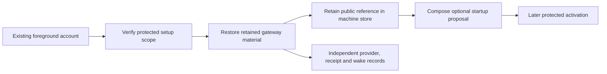

# Mac gateway preparation

Gateway preparation retains optional push material for an account with an established foreground runtime.
It preserves the existing command authority, transport identity, pairings and service configuration.
This step does not enable push or start another service.

## Material and custody

| Artifact | Contents | Boundary |
| --- | --- | --- |
| `gateway-material.cbor` | Provider credential and separate receipt and wake keys | Root-private, mode `0600` |
| Machine reference | Material digest, public keys, credential identifier and runtime scope | Protected machine database; no private key or provider credential |
| Startup proposal | Gateway settings, Root push policy, transport wake configuration and gateway job | Data only; no live file replacement or job registration |
| Existing runtime material | Established transport identity and account scope | Retained without replacement |

Creating a file-backed wake key requires an explicit custody choice.
Preparation never substitutes the authority key, transport TLS key or phone approval key.
The gateway receipt and transport wake keys are independent.

The controller restores private material before retaining its public reference.
It rereads the retained material after that commit.
An interrupted reply can resume with the same keys.
A missing private file after reference retention fails without generating a replacement.
Conflicting bytes, unsafe permissions and changed scope also fail without repair.

The native entry checks Root identity and the retained service accounts.
The eventual administrator endpoint must authenticate the caller and verify the current signed release.
No endpoint invokes this preparation yet.

## Compatibility

Machine schema 8 adds the optional material reference.
This build continues to read schemas 1 through 7.
Reading an older store does not upgrade it; explicit material retention performs the schema change.
Older binaries do not acquire schema 8 support.
The activation path must verify compatible signed components before use.

Shared setup version 1 keeps its existing encoding.
The optional gateway material does not alter those exported bytes.
The startup proposal preserves the foreground command limits, presence policy, pairing configuration, TLS identity and relay port.
The gateway storage capacity must cover the authority control budget.

## Validation boundary

Owned fixtures exercise private file publication, actual SQLite bookkeeping, lost replies and configuration composition.
The affected suite passed 157 tests without failures or skips during preparation.
The fixtures use disposable software keys and synthetic provider credentials.
They do not prove Root ownership transfer, native service isolation, installed coexistence, provider delivery or hardware custody.
The full local gate and CI remain required before merge.

The remaining integration has distinct steps:

1. Publish credentials for their dedicated service owners and prepare the gateway journal under its service UID.
2. Retain a protected activation intent and coordinate Root and transport configuration changes.
3. Register the gateway job and authorize its separate wake credential in the Root journal.
4. Connect app setup, settings and shared configuration import.
5. Verify installed services and Mac–Pixel delivery during the interactive session.

The foreground Mac–Pixel approval handoff remains separate from background push activation.

[The component record](evidence/2026-10-18-macos-gateway-material.json) covers source commit `a5681de`.
The full local gate passed 2556 core tests and 804 Kotlin/Android reports.
Assembly and lint passed with no new lint issues. The record identifies the explicit native skip and the validation limits.

[The component record](evidence/2026-10-18-macos-gateway-material-capacity-9ff9483.json) covers source commit `9ff9483`.
The full local gate passed 2557 core tests and 804 Kotlin/Android reports.
Assembly and lint passed with no new lint issues. The record identifies the explicit native skip and the validation limits.
