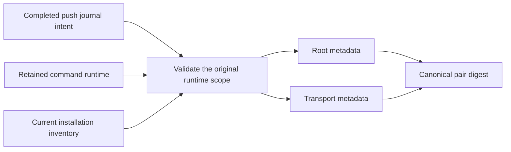

# Bind optional push inputs to the command runtime

Completed push journal setup can now produce separate Root and Transport metadata. Each record binds the setup intent and the original foreground runtime. The records contain public keys and fixed references. They contain no private identity key.

The Root record binds the original command host and phone push configuration. The Transport record binds the original Transport identity, service accounts and wake configuration. Both records require the same intent, foreground digest, material and active code policy.

Each role validates its own base configuration. The pair digest also binds the Transport polling interval and request timeout. Changing those settings changes the pair digest without replacing identities or foreground startup files.

The decoder rejects unknown fields, versions, purposes, roles and excessive input sizes. Role records cannot exchange places. Unfinished setup, foreign runtimes, mixed pairs and inactive setup code fail validation.

These records grant no activation authority or current health assertion. Protected file publication, native peer admission and live installation follow in separate changes.

## Validation

The six new controls cover completed setup, role and pair round trips, foreign or mixed scopes, timing changes, malformed records and inactive code. They use owned fixtures. The full repository gate must pass on the promoted public sources before push. Physical Mac-Pixel checks remain separate.
