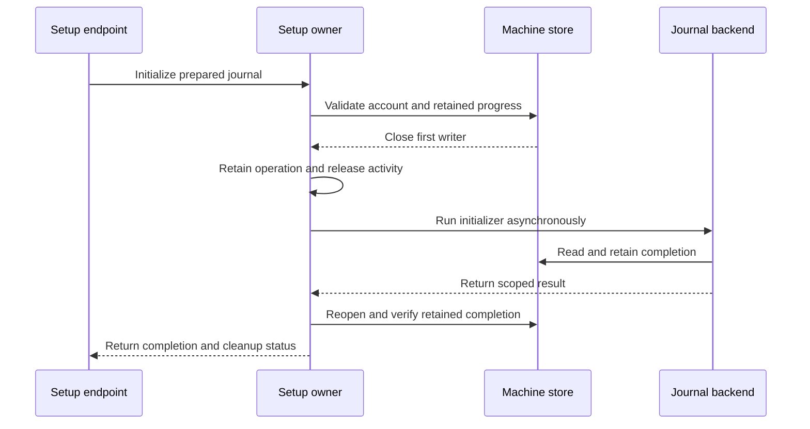

# Asynchronous Gateway journal setup

The setup owner runs the journal initializer outside its synchronous machine callback. It closes the first writer before the backend opens the machine store. A retained operation owns the release activity until the backend settles.

Shutdown rejects new operations, then waits for actual backend settlement. Cancellation does not release the activity early. An owner-bound reservation excludes every competing machine read or mutation across the asynchronous handoff. Only that operation can use its validation writers. Wrong callers, stale progress and misbound backend reports cannot return success.

Completed retries read retained completion without reopening the active journal writer. Cleanup can remain pending. That state does not prove that a temporary job stopped or that a release update is safe.

The initial isolated draft passed forty-two related controls, including eight new asynchronous owner controls. The reservation fix passes 28 related controls, including two new controls. Its held-handoff regression failed before the fix. They use real machine leases and release locks with injected initialization and report admission. Seven ordinary-user entrypoint controls refused privileged paths. The setup executable compiled through ATC without installation or launch.

The full local gate must pass on this promoted source before publication. The app-facing protocol and UI follow separately. No new exported selector is enabled here.

These controls do not prove Root initialization, installed Developer ID peers, dedicated account isolation or system launchd. Required installed checks remain in issue286. Cross-process release coordination remains in issue374. The frozen installation package is unchanged.
