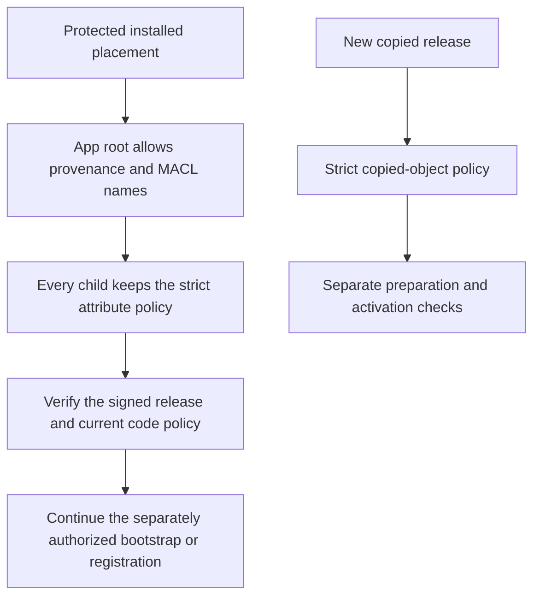

# Installed app access metadata

The first native installation placed the signed app but failed before machine bootstrap.
macOS added `com.apple.macl` to the installed app root. The copied-object validator refused that attribute.
The [sanitized record](evidence/2026-10-16-native-installer-macl.json) retains the failed result and read-only diagnosis.
The installed app's bytes, types, modes and signatures matched the prepared artifact.
No machine identity, bootstrap state, service activation or pairing was created.

[Apple DTS identifies MACL](https://developer.apple.com/forums/thread/124121?answerId=391281022) as file access consent metadata.
Remozio does not interpret its value or use it as authorization.
The app contains code and public metadata. Mutable credentials and security state remain outside the app.

## Two explicit contexts

| Object | Permitted attributes | Other required checks |
| --- | --- | --- |
| New copied release object | Existing provenance only | Existing ownership, modes, ACLs, flags, links and bounds |
| Installed app root directory | Provenance and the OS MACL label | Same metadata checks, then the signed release and current policy |
| Installed children and aliases | Existing provenance only | Same metadata checks and signed release validation |

`inspectInstalledApplication` selects the installed context explicitly and requires an app directory name.
The walker applies it only to the root directory. Files, nested directories and aliases keep the copied-object context.
The default `inspectCopiedTree` behavior is unchanged. Release preparation and durable-copy validation continue to use it.
Unknown attributes, Finder data, resource forks, quarantine, unsafe flags and mutation ACLs remain refused.
MACL does not bypass protected ancestry, ownership, stable identity, signature, role, generation or installation checks.
The code neither removes the label nor changes the installed object's permissions.
Private machine storage keeps its existing policy.

## Evidence and remaining work

A read-only ordinary-account probe uses the unchanged production validators on the actual installed app.
The ownership, mode, link, mount and POSIX ACL checks pass. The old attribute check refuses the MACL label.
A candidate probe accepts that actual root only with the installed context.
Its negative controls retain refusal for copy context, unknown attributes, file flags and non-directory use.
It changes no installed metadata and creates no private state.

The Core regression class uses real disposable extended attributes.
It checks the root-only allowance, strict copy behavior, child and alias refusal, unknown metadata, modes, ACLs and flags.
These controls do not establish corrected native installation, service admission or the complete Mac–Pixel flow.

The original installation remains failed. Preserve its partial app and all retained state.
A corrected artifact needs a concrete verified recovery step before another native installation.
For the observed uninitialized case, moving the whole failed app intact may preserve the diagnostic artifact.
Recheck absent machine state, exact code identity and daemon registrations before proposing that privileged operation.
This is not an updater for an initialized machine. It does not permit replacement of retained security floors.
[Issue #402](https://github.com/rock3r/remozio/issues/402) tracks corrected native installation and recovery evidence.
