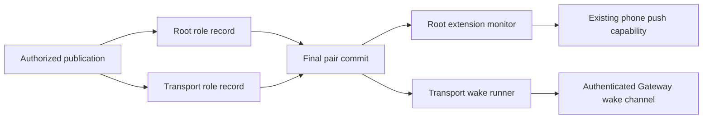

# Load optional push on running approval services

Root and Transport can load protected push inputs after foreground startup. Both keep the existing request owner, pairing state, identities and deadlines.

Publication checks existing siblings before creating missing files. It validates both role records before publishing the final commit. A retained commit forbids repair by creating missing siblings. Each loader validates its role, scope, original startup binding and the final marker again.

The Root monitor installs the exact optional provider on the existing service. Missing, malformed or changed optional records cannot replace its foreground owner. The Transport runner retries optional wake delivery without closing direct approval or pairing services. Per-attempt scope checks prevent a retired record from starting later work.

Owned shutdown cancels and joins the monitor, admitted refreshes and optional runner work. Matching installation preserves provider and probe state. These observations do not establish provider delivery or phone reachability.

## Validation and remaining integration

Focused checks cover protected publication and loading, Root lifecycle ownership and Transport wake composition. The full native and typed ATC gates must pass on this combined public candidate before push. Prior component checks do not replace those gates.

Authorized setup still needs to publish these records and activate the normal Gateway service. The app must observe current service state before reporting readiness. Owned fixtures do not prove production Root ancestry, dedicated service accounts or physical Mac-Pixel behavior. No installed service or frozen recovery artifact changes here.
