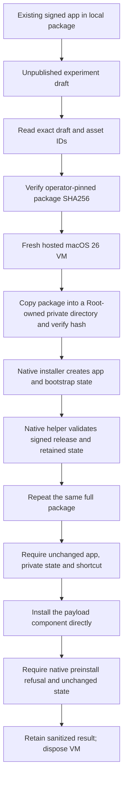

# Native package installation experiment

This manual workflow tests one pinned developer package on a disposable hosted macOS 26 VM.
It does not install anything on the user's Mac. Ordinary checks never request elevation.
No native installation result is recorded yet.



## Package transfer

Prepare the Developer ID app and local package through the [package guide](../macos-initial-package.md).
Do not export a certificate, signing password, private key, provider token or machine database.
The package contains executable code and public signature material. It contains no enrollment or user configuration.
Keep the package's actual build commit and its source qualification evidence separate from the experiment commit.
The operator-pinned hash identifies the approved artifact. A signature alone is not source-build attestation.

Create an unpublished draft with a unique tag of the form `native-installer-experiment-0123456789ab`.
Upload only the package as `Remozio-native-installer.pkg`. Keep the exact draft ID, asset ID and local SHA256.
Do not publish the draft or create a public release for this test.
The fetcher requires the fixed repository, exact IDs, expected name, uploaded state and a size below 128 MiB.
It validates the bytes and rechecks the draft after transfer. It never follows a caller-supplied API endpoint.

The workflow token has read-only repository access. It is exposed only to the download step.
[GitHub documents read permission for these endpoints](https://docs.github.com/en/rest/releases/releases#get-a-release).
Draft visibility can impose further restrictions. A refused download stops the experiment before elevation.
Do not publish the package or grant repository write permission to bypass a refused download.
After collecting the result, remove only this experiment's exact draft.
Keep a sanitized durable result in this repository before the seven-day result artifact expires.

## Explicit dispatch

After review and merge, dispatch the workflow from `main`:

```sh
gh workflow run native-package-installation.yml --repo rock3r/remozio --ref main \
  -f release_id=DRAFT_ID -f asset_id=ASSET_ID \
  -f package_sha256=VERIFIED_SHA256 -f trusted_team=TRUSTED_TEAM_ID
```

Inputs select data only. They cannot select a command, path, repository or source revision.
Both modes refuse other events, refs, repositories, hosts and local invocation before download or elevation.
These environment checks prevent accidental use. They are not attestation against a malicious local administrator.
Root subprocesses use noninteractive sudo with an empty environment. They receive no GitHub token.
The protected package copy must match the independently supplied SHA256 before installation.
The experiment accepts only the current production package scripts and their matching setup helpers.
No signature or installed-path guard is substituted.

## Controls and evidence limits

| Control | Required observation |
| --- | --- |
| Fresh full package | Native installer succeeds; archive bytes and protected ownership match; native retained inspection passes |
| Same-build full package | Installer succeeds; app bytes/inodes, the four bootstrap files and shortcut stay unchanged |
| Direct payload component | Native payload guard refuses; installer reports that refusal; established state stays unchanged |

The direct component control bypasses distribution choice convenience. It does not claim a tested Installer GUI choice override.
The four files are the startup configuration, bootstrap intent, completion record and installation database.
Their hashes and inode values stay in process memory. The result publishes fixed booleans and public artifact/provider metadata only.
A generic installer error does not count as the expected preinstall refusal.
A signal, timeout, changed state or incomplete result fails the experiment. There is no automatic retry.
The experiment leaves its installation and Root-owned transfer directory on the disposable VM.
It does not delete established state to make a retry pass. VM disposal supplies final cleanup.
No service registration, app launch or account enrollment occurs.

A repeated successful install does not establish interrupted-installation recovery.
Alternate volumes, Finder, LaunchServices, native Installer consent and the menu bar still need separate checks.
Hardware keys, installed service identities, signed IPC and the real Pixel remain in the [interactive handoff](interactive-handoff.md).
Coordinated replacement and Sparkle remain product work. The initial installer still refuses a different installed release.
This experiment is optional preparation. It must not delay an available user's first integration session.

## First hosted attempt, 16 October 2026

The [recorded attempt](evidence/2026-10-16-hosted-package-download.json) stopped at its first unpublished-draft metadata request.
The provider process returned exit 1. The original handler discarded its HTTP diagnostics, so the cause remains unknown.
The Root install step was skipped. This supplies no native installation result.
The exact temporary draft was removed. No public experiment tag remains.

The revised handler reports the process exit and one unambiguous HTTP status from the final 8192 stderr bytes.
It reports Unknown when that status is absent or ambiguous. It never prints the raw response, account text or authorization headers.
This is a reported CLI status, not proof of its underlying cause. Metadata and asset download failures use the same bounded format.
The existing download guards, token permissions and Root boundary remain unchanged.
Do not retry an unchanged failed experiment. Use a new explicit run only after the relevant fix is reviewed and merged.
