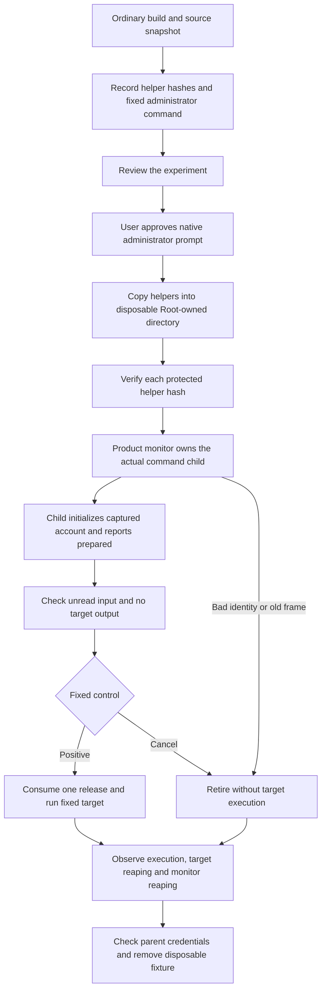

# Actual command-child experiment

This experiment prepares the actual product monitor and command child without credential substitution.
Ordinary preparation compiles the helpers and checks refusal and frame handling. It never requests elevation.
The privileged run remains a separate interactive gate. No privileged result is recorded yet.



## Fixed controls

| Control | Required observation |
| --- | --- |
| Root account | Actual target reports the expected real/effective IDs and a complete descriptor-table check |
| Ordinary account | Same checks, plus access to the extra-group fixture |
| Wrong name | No preparation, release, target output or execution |
| Missing group | Same refusal with a canonical changed group set |
| Historical frame | Product child refuses the old static-group format |
| Cancel after preparation | Input stays unread; the target never executes |

Positive controls check the queued input before release. A second release must fail.
The fixed target reads one test byte and reports booleans through its output pipe. It runs no arbitrary command.
The ordinary target opens a disposable Root-owned file through a group outside the bounded static subset.
Root file access does not establish group membership because Root bypasses file permissions.

## Ordinary checks

Run this as the ordinary account:

```sh
python3 scripts/run-production-child-experiment.py
```

The script compiles for Apple Silicon and macOS 26 with warnings treated as errors.
It checks six frames through the actual decoder and account validator, including the full Root capture.
All four binaries refuse missing arguments. The probe refuses privileged mode from an ordinary account.
Twenty-eight separate owner controls substitute monitor calls and clock readings at compile time.
They check preparation failures, early input/output, release errors, missing execution/reaping, ownership loss and clock failure or rollback.
Negative controls require the expected account or frame error. A timeout cannot count as an identity refusal.
Three actual descriptor controls also check a clean table, a leaked descriptor at 128 and the restored table.
The owner controls spawn no process and change no credentials. They establish test-owner behavior, not privileged product execution.
The normal repository gate runs these ordinary checks only.

## Prepare the interactive run

Use a new output directory whose parent exists:

```sh
python3 scripts/run-production-child-experiment.py --prepare-new-directory .build/production-child-session
```

The script reads each source once and hashes those captured bytes. It compiles a private read-only copy of those exact bytes.
Compiler inputs never refer to the live workspace. A changed workspace also prevents command publication.
The compiler and SDK remain trusted build inputs.
Read `manifest.json` and `administrator-command.txt` before the interactive run. Keep their hashes with the results.
The command accepts only the frozen ordinary UID and the four fixed helper names.
It creates a fresh Root-owned directory below `/private/var/tmp`, copies the helpers and verifies every protected copy before execution.
The directory permits traversal so the ordinary target can execute. Other users cannot replace its entries.

After review, run that exact command through native macOS administrator consent with the user present.
Do not install a service, change account membership or contact the Pixel for this experiment.
The preparation script provides no elevation switch. CI cannot start the privileged stage.

## Failure and cleanup

The Root parent owns only its monitor. The monitor owns the target wait operation.
The parent cancels through that monitor and continues polling for actual reaping. It never signals a borrowed target PID.
Any monitor polling error or protocol fault fails the control, including after release. Cleanup polling still continues.
Waits use a monotonic clock. Failed or reversed readings end the wait and preserve uncertainty.
A monitor must exit normally with the expected code. A signal or an unexpected exit code fails the control.
Monitor exit alone does not prove target cleanup. The parent also requires the monitor's actual target-reaping record.

Success requires unchanged parent IDs/groups, all six controls and confirmed cleanup.
The Root parent removes its group fixture only after owned cleanup is confirmed.
The frozen command removes only its four helpers and directory after a successful run.
Failure retains the protected directory for diagnosis. Do not erase it while ownership remains uncertain.
A failed run prints its directory and failed stage; it must not be reported as a successful experiment.

## Evidence still required

Commit only sanitized results, source/helper hashes, host versions and explicit limitations.
No secret, account name, UID, device address or real approval payload belongs in the retained record.
Actual privileged macOS 26 behavior remains separate from local macOS 27 results.
This experiment does not prove signed service admission, installed startup, pairing or the complete Mac–Pixel approval flow.
Keep [#298](https://github.com/rock3r/remozio/issues/298) open until the actual path passes.
