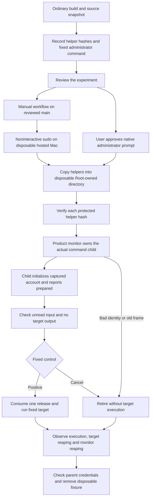

# Actual command-child experiment

This experiment prepares the actual product monitor and command child without credential substitution.
Ordinary preparation compiles the helpers and checks refusal and frame handling. It never requests elevation.
The privileged run remains a separate gate. The first hosted run failed its cleanup check; no successful privileged result is recorded.



## Fixed controls

| Control | Required observation |
| --- | --- |
| Root account | Actual target reports the expected real/effective IDs and a complete descriptor-table check |
| Ordinary account | Same checks, plus access to the extra-group fixture |
| Wrong name | No preparation, release, target output or execution |
| Missing group | Same refusal with a canonical changed group set |
| Historical frame | Product child refuses the old static-group format |
| Cancel after preparation | Input stays unread; the target never executes |

Positive controls check the queued input before release. A second release must fail.
The fixed target reads one test byte and reports booleans through its output pipe. It runs no arbitrary command.
The ordinary target opens a disposable Root-owned file through a group outside the bounded static subset.
Root file access does not establish group membership because Root bypasses file permissions.

## Ordinary checks

Run this as the ordinary account:

```sh
python3 scripts/run-production-child-experiment.py
```

The script compiles for Apple Silicon and macOS 26 with warnings treated as errors.
It checks six frames through the actual decoder and account validator, including the full Root capture.
All four binaries refuse missing arguments. The probe refuses privileged mode from an ordinary account.
Thirty separate owner controls substitute monitor calls and clock readings at compile time.
They check preparation failures, early input/output, release errors, missing execution/reaping, ownership loss and clock failure or rollback.
Negative controls require the expected account or frame error. A timeout cannot count as an identity refusal.
Three actual descriptor controls also check a clean table, a leaked descriptor at 128 and the restored table.
The owner controls spawn no process and change no credentials. They establish test-owner behavior, not privileged product execution.
Two owner controls require another status poll after monitor reaping. The final target record can arrive between the status read and monitor reaping.
The ordinary native composition test also checks eight legacy refusals through the real process and protocol code.
Only the monitor and child entry guards are substituted. The credential API keeps the real ordinary UID and cannot apply credentials.
The test never releases a target. It does not establish Root behavior.
The normal repository gate runs these ordinary checks only.

## Prepare the interactive run

Use a new output directory whose parent exists:

```sh
python3 scripts/run-production-child-experiment.py --prepare-new-directory .build/production-child-session
```

The script reads each source once and hashes those captured bytes. It compiles a private read-only copy of those exact bytes.
Compiler inputs never refer to the live workspace. A changed workspace also prevents command publication.
The compiler and SDK remain trusted build inputs.
Read `manifest.json` and `administrator-command.txt` before the interactive run. Keep their hashes with the results.
The command accepts only the frozen ordinary UID and the four fixed helper names.
It creates a fresh Root-owned directory below `/private/var/tmp`, copies the helpers and verifies every protected copy before execution.
The directory permits traversal so the ordinary target can execute. Other users cannot replace its entries.

After review, run that exact command through native macOS administrator consent with the user present.
Do not install a service, change account membership or contact the Pixel for this experiment.
The preparation script provides no elevation switch. Routine CI runs ordinary checks only.

## Explicit hosted macOS 26 run

The [manual workflow](../../.github/workflows/production-child-native.yml) runs only from this repository's `main` branch.
It does not accept a command, account or source-ref input. Its token can read repository contents only.
[GitHub documents](https://docs.github.com/en/actions/reference/runners/github-hosted-runners#administrative-privileges) passwordless sudo on its disposable hosted Macs.
The workflow still requires actual noninteractive permission and complete native results. No privileged result is recorded yet.

After the workflow passes review and merges, dispatch it once:

```sh
gh workflow run production-child-native.yml --repo rock3r/remozio --ref main
```

The job verifies its commit, captured source hashes, helper bytes and exact frozen command before elevation.
It checks the project source hashes against Git blobs from that commit. It clears the elevated process environment.
The fixed command runs on the disposable VM. It installs no service and changes no account membership.
A failed command stops collection. The job does not retry a timeout, signal or uncertain cleanup.

The collector requires all six native controls, unchanged parent credentials, confirmed owned cleanup and removal of the fixture.
Missing fields, partial results, unsupported versions and numeric substitutes for booleans fail validation.
The record contains only approved hashes, public workflow metadata, host versions and fixed result fields.
The artifact contains one `ci-evidence.json` file. The command text and its UID stay outside the artifact.

Verify the provider's successful job and the record's matching commit before using this evidence.
A JSON file alone does not prove that a job ran. Workflow environment checks prevent accidental misuse; they do not authenticate a separate caller.
This run can establish native child behavior on macOS 26. It does not establish the installed Mac–Pixel flow.

## Failure and cleanup

The Root parent owns only its monitor. The monitor owns the target wait operation.
The parent cancels through that monitor and continues polling for actual reaping. It never signals a borrowed target PID.
Any monitor polling error or protocol fault fails the control, including after release. Cleanup polling still continues.
Waits use a monotonic clock. Failed or reversed readings end the wait and preserve uncertainty.
A monitor must exit normally with the expected code. A signal or an unexpected exit code fails the control.
Monitor exit alone does not prove target cleanup. The parent also requires the monitor's actual target-reaping record.

Success requires unchanged parent IDs/groups, all six controls and confirmed cleanup.
The Root parent removes its group fixture only after owned cleanup is confirmed.
The frozen command removes only its four helpers and directory after a successful run.
Failure retains the protected directory for diagnosis. Do not erase it while ownership remains uncertain.
A failed run prints its directory, failed stage and bounded numeric state. It also prints the fixed summary to stderr.
The diagnostics preserve the primary stage when a later cleanup failure replaces it. They contain no account name, UID, PID or command payload.
The probe continues bounded status polling after monitor reaping. It still requires the target-reaping record and the expected monitor exit.
A failed run must not be reported as a successful experiment.

The [first hosted attempt](https://github.com/rock3r/remozio/actions/runs/38907371790) failed control 4, the legacy refusal, at cleanup stage 11.
Preparation and source verification passed. The native summary was not retained, so parent credentials and target cleanup remain unconfirmed.
The harness could stop polling before reading a pending target-reaping record. Controlled delayed-record tests reproduce that harness failure.
This does not establish the cause of the hosted failure. A fresh reviewed run must establish the complete native result.

## Evidence still required

Commit only sanitized results, source/helper hashes, host versions and explicit limitations.
No secret, account name, UID, device address or real approval payload belongs in the retained record.
Actual privileged macOS 26 behavior remains separate from local macOS 27 results.
This experiment does not prove signed service admission, installed startup, pairing or the complete Mac–Pixel approval flow.
Keep [#298](https://github.com/rock3r/remozio/issues/298) open until the actual path passes.
