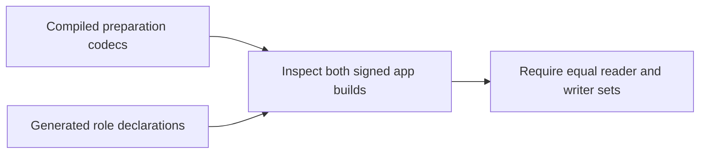

# Match the signed preparation codecs

The release manifest must describe every supported preparation schema.
Gateway material uses schema 8. Gateway journal intent uses schema 9.
The authority and setup controller read and preserve these versions.
Their signed declarations previously stopped at version 7.

The artifact check compares both roles with the compiled store constant.
The manifest declares codec support. It does not authorize migration or activation.
Existing migration declarations remain unchanged.
No installed app or service changes in this experiment.

[The frozen gate evidence](evidence/2026-10-18-macos-release-preparation-declarations.json) records 2622 passing core tests, 804 Kotlin/Android reports, assembly and lint.
