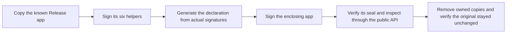

# Complete release signature experiment

The native probe calls the public `SignedReleaseInspection` API. It does not use the internal ad-hoc test seam.
The default run proves rejection of the built ad-hoc Release app without a private signing identity.

Run `python3 scripts/check-macos-app.py` first. Then run `python3 scripts/run-macos-release-signing-experiment.py` without elevation.
The ordinary macOS gate builds the probe and runs its default rejection check. Python tests check unsafe-copy and evidence failures.

Developer ID mode requires both `--signing-identity CERTIFICATE_SHA1` and `--trusted-team TEAM_ID`.
Replace both placeholders with an explicitly approved certificate fingerprint and independently trusted Team ID.
The runner does not discover a signing identity or derive trust from the candidate.
An unavailable key or signing timeout fails this opt-in experiment. It never counts as expected rejection.
The runner does not retrieve passwords or vault secrets or operate authentication UI.

| Case | Required result |
| --- | --- |
| Complete Developer ID bundle | Accepted with seven components and seven hashes |
| Wrong trusted Team ID | Rejected |
| Wrong expected app identifier | Rejected |
| Original ad-hoc release | Rejected |
| Validly signed undeclared helper | Rejected |
| Validly signed foreign app entitlement | Rejected |

The runner signs only owned temporary copies. It rejects aliases and special files before copying or signing.
It checks the original bundle fingerprint again on success or failure. Evidence contains public identity fields and sanitized outcomes.
Every signing and inspection subprocess has a deadline. A timeout records failure or uncertainty, never acceptance.

This proves candidate signature inspection on the recorded host. It does not prove protected placement, activation, installed continuity, revocation, notarization or secure timestamps.
The app and its helpers are not launched. No service is installed and no private key is exported.
A deployment target of macOS 26 does not establish macOS 26 runtime behavior.

## Recorded evidence

The [11 October 2026 record](evidence/2026-10-11-release-signing.json) contains all six passing Developer ID controls.
The host ran macOS 27.0.1 on arm64 with SDK 27.0 and a deployment target of 26.0.
The record includes public identity fields, source hashes and the native probe hash. The original remained unchanged and owned copies were removed.
The signing key was available without password retrieval or authentication UI automation.
Default rejection also passed with the same probe. This remains candidate inspection evidence, not distribution or installation proof.
