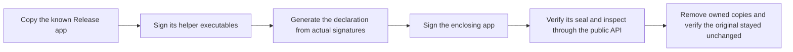

# Complete release signature experiment

The native probe calls the public `SignedReleaseInspection` API. It does not use the internal ad-hoc test seam.
The default run proves rejection of the built ad-hoc Release app without a private signing identity.

Run `python3 scripts/check-macos-app.py` first. Then run `python3 scripts/run-macos-release-signing-experiment.py` without elevation.
The ordinary macOS gate builds the probe and runs its default rejection check. Python tests check unsafe-copy and evidence failures.

Developer ID mode requires both `--signing-identity CERTIFICATE_SHA1` and `--trusted-team TEAM_ID`.
Replace both placeholders with an explicitly approved certificate fingerprint and independently trusted Team ID.
The runner does not discover a signing identity or derive trust from the candidate.
An unavailable key or signing timeout fails this opt-in experiment. It never counts as expected rejection.
The runner does not retrieve passwords or vault secrets or operate authentication UI.

Use `--secure-timestamp` to request timestamps explicitly for a later notarization candidate.
This option requires a signing identity and network access. It does not submit the app to Apple.
The [notarization workflow](../macos-notarization.md) independently checks timestamps on all eight roles before submission.

The profileless Developer ID export signs the enclosing app with an empty entitlements dictionary.
Its identifier, publisher, hardened runtime and exact hashes still undergo the production checks.
The foreign-identity rejection fixture alone adds identity entitlement claims.
Apple explains restricted claims and Developer ID profiles in [TN3125](https://developer.apple.com/documentation/technotes/tn3125-inside-code-signing-provisioning-profiles).

| Case | Required result |
| --- | --- |
| Complete Developer ID bundle | Accepted with eight components and eight hashes |
| Wrong trusted Team ID | Rejected |
| Wrong expected app identifier | Rejected |
| Original ad-hoc release | Rejected |
| Validly signed undeclared helper | Rejected |
| Validly signed foreign app entitlement | Rejected |

The runner signs only owned temporary copies. It rejects aliases and special files before copying or signing.
It checks the original bundle fingerprint again on success or failure. Evidence contains public identity fields and sanitized outcomes.
Every signing and inspection subprocess has a deadline. A timeout records failure or uncertainty, never acceptance.

This proves candidate signature inspection on the recorded host. It does not prove protected placement, activation, installed continuity, revocation or notarization.
The default run has no secure timestamps. An opt-in timestamp request alone does not prove a notarization result.
The app and its helpers are not launched. No service is installed and no private key is exported.
A deployment target of macOS 26 does not establish macOS 26 runtime behavior.

## Recorded evidence

The [11 October 2026 record](evidence/2026-10-11-release-signing.json) contains all six passing Developer ID controls.
The host ran macOS 27.0.1 on arm64 with SDK 27.0 and a deployment target of 26.0.
The record includes public identity fields, source hashes and the native probe hash. The original remained unchanged and owned copies were removed.
The signing key was available without password retrieval or authentication UI automation.
Default rejection also passed with the same probe. This remains candidate inspection evidence, not distribution or installation proof.

## Native launch control, 16 October 2026

The [native record](evidence/2026-10-16-profileless-app-launch.json) separates signature inspection from actual app launch.

| Candidate | Static checks | Native launch |
| --- | --- | --- |
| Former enclosing signature with identity claims and no profile | Accepted | AMFI refused a missing profile |
| Disposable copy with empty entitlements, same publisher and hardened runtime | Accepted | Remozio main window opened |

The control changed only the enclosing signature of a disposable copy from source `fe99464`.
Process inspection confirmed that exact copy. It showed the expected notice for placement outside the installed path.
No setup action or service registration ran. The copy then quit normally.
The protected app and initialized machine state stayed unchanged.
This does not establish notarization, installed service eligibility or macOS 26 behavior.

The initialized machine retains the former release digest and app hash.
The corrected signature changes that digest. The initial package cannot replace it.
A verified transition remains required before the corrected app can operate on that machine.
Do not overwrite the protected app, reset the machine or recreate keys to bypass its retained policy.
Track signing in [#404](https://github.com/rock3r/remozio/issues/404) and installation in [#402](https://github.com/rock3r/remozio/issues/402).
