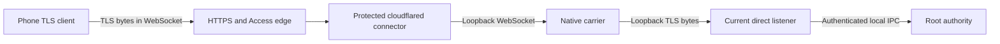

# Native approval relay

The Mac transport can carry the approval channel through a loopback WebSocket endpoint.
It forwards opaque TLS bytes to its current direct listener.
The direct listener still verifies enrolled phones and negotiates the Remozio channel.
The authority still verifies requests and decides which action wins.

The diagram shows the intended remote route.
This change implements the native carrier and its transport lifecycle.
It does not provision the edge or start cloudflared.

## Startup and ownership

Use `RemozioTransport --remote-configuration PATH` with protected public metadata.
The version 1 configuration holds the existing transport configuration, an optional wake configuration, and a fixed relay port.
The wake configuration must contain the exact same transport identity and configuration.
Existing direct and wake startup formats remain supported.

Only the configured service account can load this startup file.
The carrier binds IPv4 loopback.
A future protected tunnel configuration must route its approval endpoint to `127.0.0.1:<relay-port>`.
The carrier cannot select a host, accept a destination from a caller, or proxy another local service.
It uses no TLS private key, authority key, Access secret, or request decoder.

The carrier selects `remozio.ciphertext.v1` when the client offers that supported protocol.
The comparison removes HTTP whitespace from offered protocol tokens.
It does not negotiate compression.
Native WebSocket framing has a 32 KiB message limit, including fragmented messages.
Ping, pong, and empty binary messages add no bytes to the TLS stream.
Text and oversized messages close the connection.

Network.framework can report connection readiness before validating the upgrade.
The carrier therefore waits for the first validated binary message before it opens the fixed destination.
A deadline covers the upgrade and first ciphertext.
The TCP connection also has an opening deadline.
Both deadlines use the configured transport timeout.

Each direction waits for the preceding write.
The carrier holds one input chunk per direction and caps concurrent connections with the transport setting.
EOF, failure, cancellation, or owner shutdown aborts both sockets.
Shutdown waits for the connection tasks.
It never resends application data or reports an approval outcome.

The coordinator follows measured direct-listener state.
It closes the old carrier before replacing a changed destination.
Authority loss or lack of enrolled phones removes the endpoint.
Late callbacks cannot restore an old or failed incarnation.
Relay failures retry after a bounded delay and leave direct transport running.
A port collision reports local relay failure; it never selects another destination.

## Evidence and limits

Run `python3 scripts/run-native-approval-relay-experiment.py`.
The experiment builds a probe that uses the production carrier.
It runs as an ordinary user with disposable loopback sockets and certificates.

The first regression failed because a rejected upgrade reached the TCP destination.
The corrected carrier rejects it before opening that destination.
The experiment also checks text rejection, single and fragmented message limits, control frames, empty messages, and protocol fallback.
It checks a silent upgrade deadline, the connection cap, and shutdown while both sockets are open.
A 50,000-byte exchange passes through mutual TLS 1.3 with certificate verification at both ends.

The TLS fixture uses the same disposable certificate for both roles.
It proves opaque forwarding, not Remozio enrollment or production key custody.
The observed host runs macOS 27.0.1; the binaries target macOS 26.
A macOS 26 runtime remains untested.

Unit tests check protected configuration, retry delays, replacement, authority loss, and shutdown during replacement.
The bundle check verifies remote startup refusal with missing provisioning.

Cloudflare Tunnel and Access, Pixel interoperability, mobile data, and protected service installation remain untested.
No production identity, installed service, or privileged action is used by the experiment.
