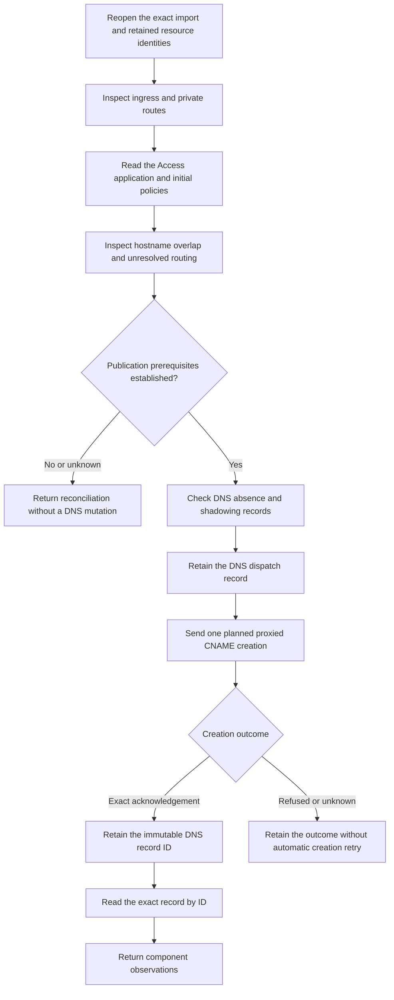

# Retained relay DNS publication

This slice joins the created tunnel and Access application to one retained DNS creation attempt.
A provider acknowledgement is not proof of propagation or a working relay.

The publication check combines current ingress, private-route, Access and DNS observations.
It checks retained resource digests and revalidates local import state around every network operation.
The observations do not lock provider state or grant a reusable publication permit.

Hostname assessment distinguishes no other observed match, simple broader wildcard roots and unresolved precedence.
The current assessment infers precedence for simple broader wildcard roots from the vendor's specificity rule.
Real hostname precedence and edge propagation remain integration gates.
Complex paths, public overrides, duplicate matches and unresolved application fields require reconciliation.

The DNS client selects only the configured zone, planned hostname and retained tunnel target.
Creation requests a proxied CNAME with automatic TTL.
Readback verifies the recorded ID, exact target and proxy settings, including observable shadowing metadata.
Creation and readback require the requested metadata object. A missing or null object cannot verify the record.
A matching name cannot adopt an unrecorded resource.

Creation is dispatched only after retaining its attempt.
Lost, ambiguous or crossed replies stay unknown and are not automatically retried.
A validated late acknowledgement can be retained before reporting cancellation when the current scope still permits recording it.
Scope changes that prevent recording leave the earlier dispatch unresolved.

## Validation boundary

The focused run passed 309 synthetic controls at source `8ba3dcc`, with no failures or skips.
It covered the tunnel, Access, private-route and DNS sequence on the integrated dependency.
This focused result does not substitute for the complete publication gate.

The complete local publication gate passed at source `c447214` on 2026-10-20.
The published source `a233b588` has the same complete tree.
The run passed 3,853 native tests, with one existing skip, and 851 portable tests.
It also passed Android assembly and lint, Mac interoperability, the unsigned iOS app build and both leased Kotlin simulator suites.

The host used macOS 27; supported macOS 26 runtime behavior remains untested.
Fixtures use temporary files and synthetic provider responses.
They cover exact bindings, changed prerequisites, late creation, cancellation, unknown outcomes and independent record readback.

No real DNS or Access change, native credential access, service installation or device operation belongs to these checks.
A real end-to-end relay, background phone delivery and final import completion remain unproven.
The app import action and native relay startup remain separate implementation work.

The hostname assessment is based on [Cloudflare application paths](https://developers.cloudflare.com/cloudflare-one/access-controls/policies/app-paths/).
Its native behavior must be checked before claiming provider compatibility.
