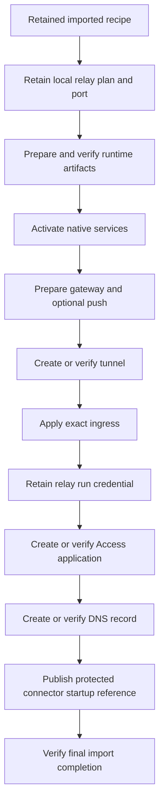

# Imported relay setup and native runtime activation

## Purpose

Keep each Mac's relay resources local when it imports shared setup choices.
Retain the selected local port and provider resource identities across interrupted setup.
Join that retained selection to native runtime preparation and activation.

## Retained records

The import owner stores separate protected records for the relay plan, tunnel creation, Access application and DNS publication.
Each record binds the exact import scope and local operation.
Returned provider identities cannot change during recovery.
File snapshots retain identities and digests so replacement or mutation cannot silently change an accepted selection.
Unknown files remain incompatible state. They are not removed or treated as an empty store.

The setup owner holds the machine and import leases while it validates these records.
A missing accepted output cannot be repaired after runtime publication.
A port collision never silently selects another port after retention.
The native preparation entry point reopens the current import and validates its relay selection around publication callbacks.
Activation uses the same retained recipe and configuration scope.
The current root artifact reader and original service caller restrictions remain intact.

## Current implementation and validation

The native import action now connects these records to runtime preparation and connector publication.
[Refusal recovery](portable-provider-refusal-retry.md) adds scoped metadata reads and explicit retries for confirmed rejections.
Unknown provider outcomes cannot be replayed or adopted by name.
The diagram shows the default import order. Internal preparation methods still validate their own retained prerequisites.

The [owned loopback experiment](relay-connector-loopback.md) combines the process primitive, supervisor and real readiness client.
Its fixture responses test readiness behavior without a live provider connection.
The installed factory still requires the dedicated service identity and protected signed release.
That factory and the live Mac-Pixel approval flow remain supervised gates.
The complete repository gate must pass before publication; earlier focused runs do not qualify the current private tree.
