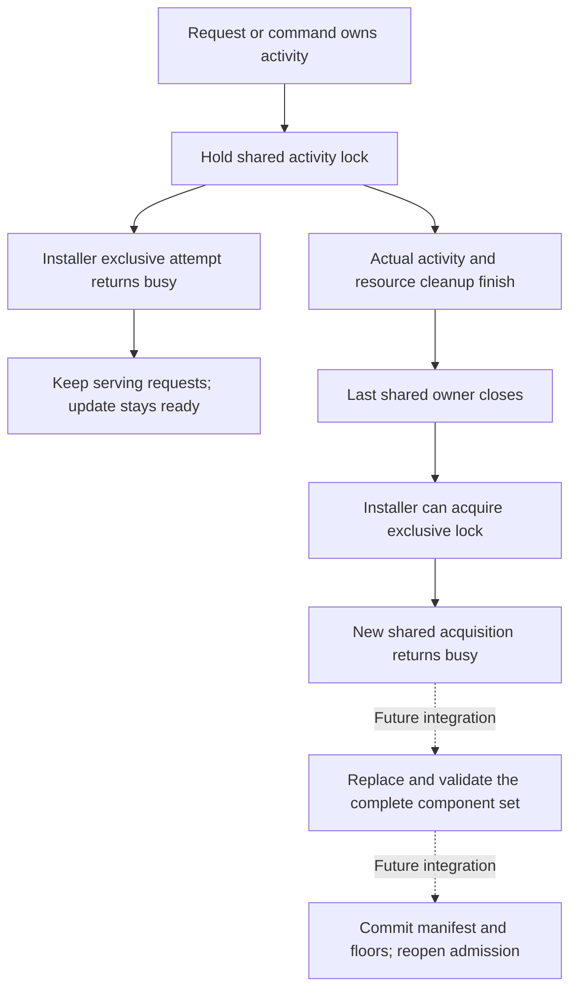

# Release activity barrier experiment

Nine ordinary-account controls passed on Apple Silicon macOS 27.0.1.
All ten owned children were reaped. No Root operation, service registration or production update ran.
The [sanitized result](evidence/2026-10-16-release-activity.json) retains the source hashes.

This tests a candidate coordination mechanism. The app does not use this barrier yet.
It does not establish macOS 26 runtime behavior or protected update activation.

## Candidate boundary



The diagram describes the intended use of the measured lock behavior.
Its request ownership, replacement and recovery steps remain implementation work.
A failed automatic attempt must leave normal admission available.

## Measured controls

| Control | Observed result |
| --- | --- |
| Independent shared owners | Both hold the lock. Exclusive acquisition stays blocked until the last owner closes. |
| Exclusive owner | A new shared owner is refused. It succeeds after the exclusive owner closes. |
| Failed automatic attempt | A refused exclusive attempt does not prevent another shared owner from entering. |
| Duplicated descriptor | Closing one reference retains the lock. Closing the last reference releases it. |
| Fork and close | Closing the child's inherited reference does not release the parent's remaining lock. |
| Fork and explicit unlock | Negative control: the child can release the parent's inherited lock. |
| Close on exec | The barrier descriptor closes during exec. Exclusive acquisition succeeds while the new child image remains alive. |
| Owned child crash | After the child is killed and reaped, its lock no longer blocks an exclusive owner. |
| Path replacement | Negative control: a new file at the same path can have an exclusive lock while the old file remains shared. |

The parent uses control pipes to observe each relevant boundary.
Its wait owns each child until reaping. Cleanup never signals after child ownership is lost.
The probe refuses Root and mixed identities before starting controls.
It refuses optimized Python execution because the controls use assertions.
The runner uses isolated Python execution and rejects incomplete or broadened evidence.

## Run and cleanup

```sh
python3 scripts/run-release-activity-experiment.py
```

Run this as an ordinary account on an Apple Silicon Mac.
The probe creates a private temporary directory and one disposable lock file.
It creates no system service and changes no terminal, credential, pairing or installed application.
Normal completion removes the temporary files after all children exit.
A timeout or failed control produces no passing evidence.
The repository's Mac gate runs the same experiment.

## Implementation consequences

[Apple documents these locks as advisory coordination between cooperating processes](https://developer.apple.com/library/archive/documentation/System/Conceptual/ManPages_iPhoneOS/man2/flock.2.html).
They do not authorize an update or prevent a process from ignoring the protocol.
Use a separate installer descriptor. Changing an existing shared lock to exclusive can release the previous lock before acquisition succeeds.

Protect the lock file and its ancestors. Revalidate the retained file identity.
A pathname alone cannot define the barrier, as the replacement control demonstrates.
Close inherited references without explicitly unlocking their shared description.
Keep barrier descriptors closed across exec.

Production must bind activity to the actual serialized request and execution owners.
Hold it through native child ownership, command I/O cleanup and live GUI permits.
An empty request list alone does not prove quiescence.
All affected roles must participate before a bundle can be replaced.
A compromised transport must not be able to assert that Root activity is idle.

An exclusive lock is only one activation prerequisite.
Signed staging, current generations, compatibility, service identity, durable activation recovery and the final floor commit remain required.
Installer or authority crashes also need state reconciliation. Lock release alone cannot establish a complete compatible installation.
The [Sparkle replacement experiment](sparkle-replacement-boundary.md) still governs delivery into a separate staging copy.

No automatic admission freeze, command termination, forced pairing or new update prompt is introduced by this experiment.
