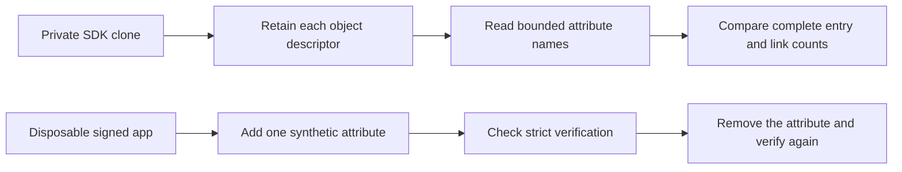

# Release file attribute experiment

The experiment inventories attribute names on an owned SDK clone.
It also checks a disposable signed app with three synthetic attributes.
It selects no production copying policy.



## Run

Select an existing Developer ID Application identity and its Team explicitly.
Keep credentials outside the repository.

```sh
python3 scripts/run-release-attributes-experiment.py \
  --identity '<Developer ID identity>' --team-id '<Team ID>'
```

The runner builds its probe and reuses the existing Sparkle SDK dependency.
It prints the complete evidence record, including measured test counts and hashes for all seven validation sources.
It verifies the fixture Team, removes its private directories, and checks the original SDK bytes and links.
It never executes the signed app.

## Observations

| Control | Measured result |
| --- | --- |
| SDK inventory | All 150 entries and nine links matched an independent tree walk |
| Symlink descriptor | Names belong to the link; target-only attributes do not appear |
| Custom resource attribute | Strict signature verification still passed |
| Ordinary resource fork | Strict signature verification failed |
| Finder metadata | Strict signature verification failed |
| Attribute removal | Baseline strict verification recovered after every control |

The eight Swift tests cover file, resource, Finder, quarantine and custom names.
They check inventory limits, invalid descriptors and symlink behavior.
`O_SYMLINK` retains a link itself. Combining it with `O_NOFOLLOW` failed with `ELOOP` on the tested host.

The inventory probe reads no attribute values. The record reports names and counts only.
The fixture copier preserves metadata internally; the signed verifier can inspect it.
Each inventory permits at most 8,192 name bytes and 64 names.
The traversal permits at most 8,192 entries and 16 directory levels.
The SDK comparison bounds file data to 1 GiB.
Three runner tests check identity and host refusal before any build or signing operation.

## Limits

The observations describe the recorded host and fixtures.
They do not establish a metadata seal, immutable source tree, or activation authority.
Signature verification alone does not define the copying policy for arbitrary attributes.
Compressed resource forks remain unproven.
A separate `ditto --hfsCompression` attempt produced an ordinary file and did not establish compression support.
The macOS 26 deployment target does not establish macOS 26 runtime behavior.
No Root process, protected service, installed app, notarization, or physical device was used.

The [evidence record](release-attributes.json) includes the host, controls and source hashes.
