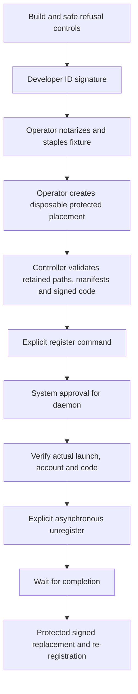

# Protected service lifecycle experiment

The disposable app can exercise Apple's service registration APIs during an interactive session.
It contains an ordinary-account controller, one Aqua agent and one Root daemon.
It has no keys, listeners, approval RPC or command execution interface.
The production Remozio app does not activate these services.



Only the build and refusal controls have run.
The arrows show required evidence, not completed operations.

## Apple API constraints

[SMAppService](https://developer.apple.com/documentation/servicemanagement/smappservice) manages helpers inside the calling app bundle.
The installed SDK requires signed apps and notarized apps for launch daemons.
It recommends placement accessible before GUI login.
A daemon needs administrator approval in System Settings before launch.
An agent must be registered in each intended user's context.

Changing a manifest or executable requires re-registration.
Unregister terminates a running helper.
The [asynchronous operation](https://developer.apple.com/documentation/servicemanagement/smappservice/unregister(completionhandler:)) supplies the completion boundary before re-registration.
The production updater must reach its approved idle boundary before unregistering services.
This experiment does not establish that boundary.

## Build without changing services

On Apple Silicon with the macOS 26 SDK or later:

```sh
python3 scripts/check-service-lifecycle.py
```

The script builds an arm64 Swift 6 app, signs it ad-hoc, and deletes its temporary copy afterward.
It checks both helpers, read-only status, exact manifests, missing confirmation, wrong roles and ordinary-account placement refusal.
It checks ad-hoc signature rejection and rejects altered labels, arguments, account selection and KeepAlive.
It never invokes a confirmed unregister command.
Confirmed register commands run only against its user-owned temporary app and fail before the framework call.
The authority helper refuses ordinary-account service startup before its long-lived path.
No automated check starts the session helper's long-lived path.

To keep a new Developer ID fixture:

```sh
mkdir -p experiment-results/service-lifecycle
python3 scripts/check-service-lifecycle.py \
  --developer-id '<approved certificate name or SHA-1>' \
  --keep-output experiment-results/service-lifecycle/RemozioServiceLifecycle.app \
  --output experiment-results/service-lifecycle/build.json
```

Existing output paths are refused.
The selected certificate must match the test Team ID `PVDFPZ5D64`.
The script retrieves no credentials and changes no Gatekeeper policy.
The Developer ID checks also verify the publisher and reject the freshly built, unnotarized fixture.
A signing pass does not establish notarization or service eligibility.

The [sanitized evidence](service-lifecycle.json) binds the source hashes and records all unrun platform cases.
The recorded host runs macOS 27.0.1. The deployment target does not prove macOS 26 runtime behavior.

## Registration boundary

| Check | Requirement |
| --- | --- |
| Operator | Real and effective ordinary UID must match |
| Placement | Root-owned local bundle, every ancestor and every bundled object; no symlinks, hard links or unsafe modes/ACLs |
| Identity | Approved Developer ID chain, Team ID and exact experiment identifiers |
| Runtime | Hardened runtime; no entitlements |
| Notarization | The app must satisfy the native `notarized` code requirement |
| Manifests | Exact fixed labels, executable paths, arguments, account and session settings |
| Intent | Explicit role and `--confirm-disposable-service-test` |

The placement owner retains descriptors through the synchronous registration call and rechecks named identities.
It reuses Core's protected metadata validator without modifying that validator.
Removal remains reachable after a valid signed test app moves.
It still requires the approved publisher, exact manifests and explicit confirmation.
It waits for the asynchronous framework callback.
An error claims neither successful removal nor safe replacement.

The status value `eligibleNotVerifiedRunning` means eligibility only.
Verify the actual job and source process separately.
Read-only manifest and publisher inspection never grants registration permission.

## Interactive procedure: not run

Perform these steps only with the operator at the Mac.
Select this experiment deliberately. Do not substitute the production authority app.

1. Build and preserve the selected Developer ID fixture. Record its source hashes and code hashes.
2. Submit that fixture through the operator's notarization workflow. Staple and validate the ticket. Preserve the same signed bytes.
3. Choose a new disposable directory beneath an existing protected, boot-accessible local ancestor.
   `/Library/PrivilegedHelperTools/RemozioServiceLifecycleExperiment` is a candidate, not a validated placement.
   Do not change permissions on shared system directories to make a check pass.
4. Use explicit Root authorization to copy only this fixture into that new directory.
   Set the copy and its contents to Root ownership and safe permissions before launching the controller.
   Verify its complete signature again. Keep the source copy for removal if the installed copy becomes unavailable.
5. Run the installed controller as the intended ordinary GUI account. Start with `--status` and `--preflight`.
6. Register the session probe. Verify the actual agent, executable and UID in the intended GUI bootstrap domain.
7. Register the authority probe. Approve only the experiment in System Settings.
   Verify the actual daemon, executable and UID in the system bootstrap domain.
8. Associate startup logs with that verified process and signed artifact. A matching log string alone is not provenance.
9. Observe lock, logout and a reboot to the login window. FileVault preboot remains outside scope.
10. Unregister each exact experiment role. Wait for the controller's successful asynchronous result.
    Verify that the exact job and process are gone before replacing the fixture.
11. Copy a second protected, signed and notarized build. Re-register from the intended account and repeat process verification.
12. Remove only the exact experiment jobs and owned copies. Preserve evidence and report uncertain cleanup separately.

Example commands after protected placement and notarization:

```sh
# Replace this path with the verified installed fixture. Run as the ordinary GUI account.
TASK_PROBE_APP='/Library/PrivilegedHelperTools/RemozioServiceLifecycleExperiment/RemozioServiceLifecycle.app'
"$TASK_PROBE_APP/Contents/MacOS/RemozioServiceLifecycle" --status
"$TASK_PROBE_APP/Contents/MacOS/RemozioServiceLifecycle" --preflight
"$TASK_PROBE_APP/Contents/MacOS/RemozioServiceLifecycle" --register session --confirm-disposable-service-test
"$TASK_PROBE_APP/Contents/MacOS/RemozioServiceLifecycle" --register authority --confirm-disposable-service-test
# Later, after collecting evidence and closing the test session:
"$TASK_PROBE_APP/Contents/MacOS/RemozioServiceLifecycle" --unregister session --confirm-disposable-service-test
"$TASK_PROBE_APP/Contents/MacOS/RemozioServiceLifecycle" --unregister authority --confirm-disposable-service-test
```

Helpers log only role, numeric UID and startup/termination messages through Unified Logging.
They read no credentials or command input.
Their service mode waits for termination and can consume resources until removed.
Do not use that mode as an ordinary build smoke test.

## Remaining gates

Registration, Root placement, notarized acceptance, reboot, replacement and actual removal have not run.
Dedicated transport-account behavior and pre-login hardware key access need separate fixtures and evidence.
This app grants no production activation, anti-rollback, installer, enrollment or update-quiescence proof.
Use the [interactive handoff](interactive-handoff.md) to retain those requirements.
