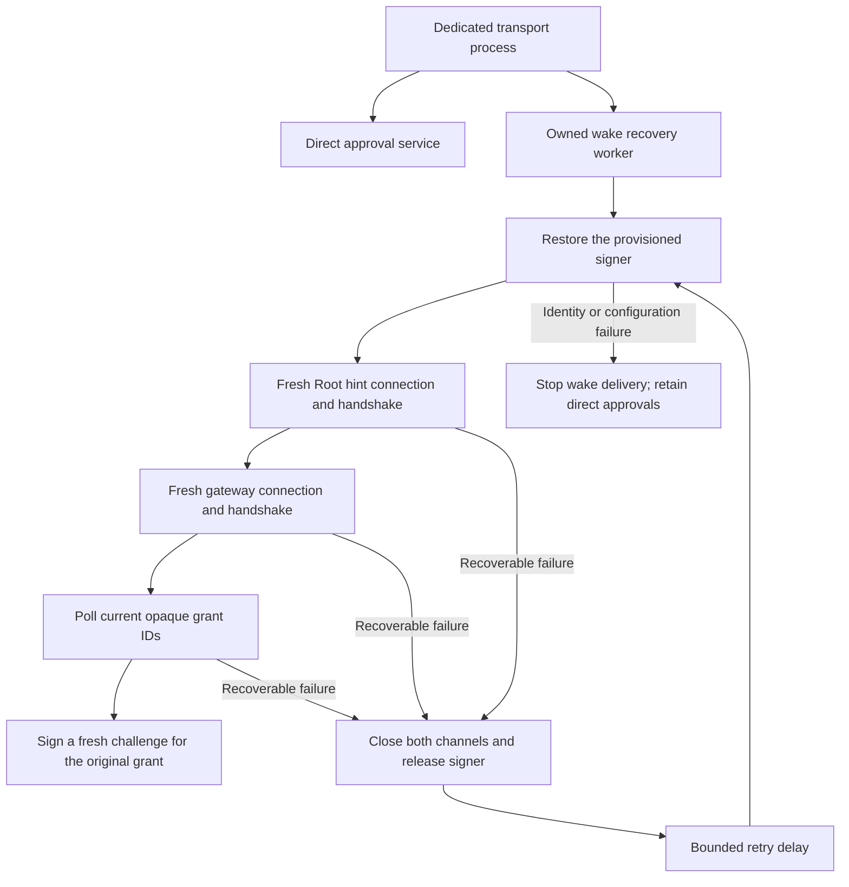

# Transport wake recovery

The embedded transport owns a wake recovery runner alongside the direct approval service.
A starting or restarting gateway must not permanently disable wake delivery.



## Recovery and scope

Each attempt uses the same protected startup metadata, account, gateway binding, credential ID, public-key pin, and chosen custody. It restores the existing key and creates new channel objects. It never generates a replacement key, switches custody, or weakens peer authentication.

Closed connections, timeouts, unsupported wake versions, channel framing failures, and temporary signer unavailability retry. Identity, account, configuration, and ownership errors stop the wake worker. Other unclassified errors also stop it. The direct approval service has its own lifetime and connection.

The default retry delay starts at one second and caps at 30 seconds. A successful poll resets the delay. The runtime owner can supply retry bounds. Poll timing comes from the existing protected wake configuration.

```mermaid
sequenceDiagram
    participant R as Recovery runner
    participant H as Root hint connection
    participant G as Gateway connection
    R->>H: Authenticate and negotiate a fresh connection
    H-->>R: Original current grant ID
    R->>G: Authenticate; request a fresh challenge
    R->>G: Signed wake for that original ID
    G-->>R: Accept; gateway owns provider retries
    H-->>R: Connection lost
    R->>H: Close and release
    R->>G: Close and release
    Note over R: Wait; restore the pinned signer; create both connections again
```

Recovery creates no request, recipient, approval, or deadline. The Root hint feed remains authoritative. Each attempt remembers accepted IDs while they remain in its hint feed. Reconnection can submit an original current ID again with a new challenge. Gateway admission and provider ownership remain unchanged.

## Shutdown

Shutdown prevents new attempts, cancels the worker, and waits for active startup or polling work. It then closes the retained channels and releases the signer. A factory that finishes after shutdown still transfers its resources for cleanup; its channels never start.

Concurrent close calls share one cleanup attempt. Successful close is idempotent. Releasing the runner also cancels the worker and schedules owned cleanup. A delayed report cannot restart work.

## Evidence and remaining gates

The focused gate passed 21 tests on 2026-10-11. Eleven runner tests cover retry bounds, signer outage, channel startup and polling failure, permanent identity errors, cancellation, concurrent close, and release cleanup. Ten hint/runtime tests cover negotiation, scope, signing, and connection independence.

The recovery composition uses the actual client actors with synthetic drivers and software fixture keys. It proves fresh handshake ordering and signatures for the original grant ID. An ordinary approval connection stays usable through recovery and a permanent wake signer failure. Accepted hints are not repeatedly submitted during a healthy attempt.

The malformed-response regression first failed for invalid CBOR, unknown fields, noncanonical IDs, wrong scope, and invalid IDs. The channel now classifies all hint decoding failures as an invalid message. Each case rejects the payload without requesting a challenge or signing it, closes that attempt, and recovers through fresh channels using the original pinned scope.

These checks do not prove installed account custody, real IPC reconnection, provider delivery, or enrolled phone behavior. The embedded app build verifies compilation and rejection paths only. [Issue 286](https://github.com/rock3r/remozio/issues/286) retains installed and physical platform gates.
