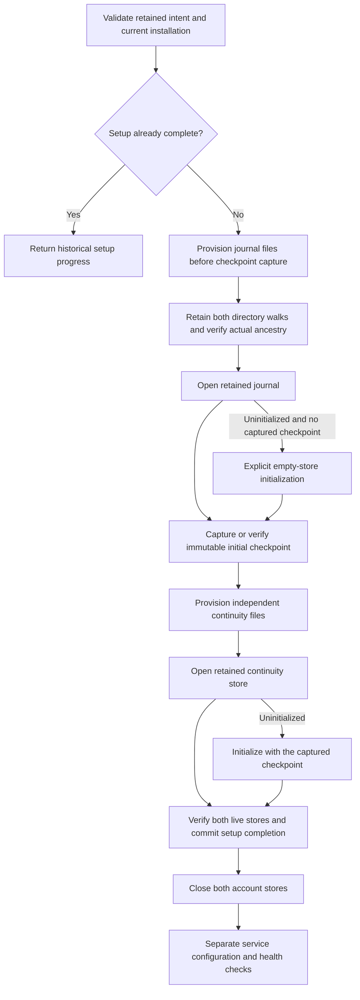

# Resumable account storage setup

`AuthorityAccountInitialization.resume` runs the saved setup stages as one serialized Root operation.
The host must first verify administrator consent, signed code, protected account scope and the current installation.
The operation does not register services, enroll phones or grant command admission.

The controller validates the retained revision, installation, release and account before each storage step.
It retains both protected directory walks and rejects physical containment before initializing either database.
Each database lease must match its retained directory identity before SQLite opens.
This also covers different spellings on case-insensitive filesystems.
It opens existing stores first. Explicit initialization still requires the store's own empty-schema checks.
A captured checkpoint forbids journal recreation or initialization after journal loss.
An unknown journal, mismatched continuity checkpoint or active writer stops setup without replacing retained state.

Interruption releases both account stores. Reopening the machine store supplies the latest retained progress.
Recovery preserves the original declaration and checkpoint. It cannot generate a replacement boundary.
Completion remains historical setup evidence. A retry returns that evidence without opening or repairing account stores.
Current health still requires runtime startup and authenticated service checks.

Eleven ordinary-owner controls use actual protected files, leases, provisioners and SQLite stores.
They cover complete initialization, every stage interruption, historical completion, stale revision, changed release,
known journal and directory loss, unknown journal schema, mismatched continuity, case aliases, writer exclusion and the public Root gate.
Removing the captured-checkpoint guard causes the journal-loss control to fail twice.
Restoring the guard passes the focused controls.
The case-alias regression fails before the fix. Both containment directions pass after the fix on the local case-insensitive volume.
A case-sensitive fixture volume skips that platform-specific control.
These controls do not prove Root behavior, power-loss recovery or installed service operation.

The bundled administrative host still needs authenticated typed IPC and administrator authorization before calling this operation.
The setup UI, configuration publication, service registration and real Mac–Pixel approval remain unfinished.
