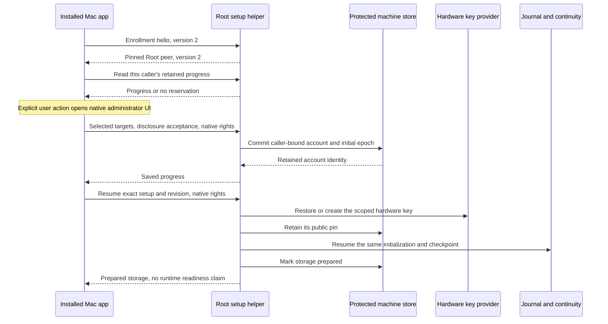

# Mac account preparation

The installed app can prepare command approval storage for its authenticated local Mac account.
The user selects target UIDs and accepts the separate Remozio command policy before administrator authorization.
This policy does not inherit sudoers restrictions.

## Ownership and recovery

The endpoint derives the caller UID from its authenticated XPC invocation.
The helper queries `/Local/Default` for that UID and retains the directory UUID.
A replacement account with the same UID cannot claim the retained preparation.
A primary group change does not replace the account identity.
Each local account receives a separate random Remozio account ID and separate storage directories.

The reservation freezes the installation, release, command grants, initial epoch and current code policy.
It commits before key or journal creation.
Repeated preparation restores those inputs. It cannot replace the grants or create another epoch.
Different grants require a separate future policy-change operation.

The controller pins the key before it starts journal initialization.
Retained initialization checkpoints preserve the journal and continuity boundary across crashes.
Completed preparation never recreates a missing key or database.
A lost reply requires a fresh progress read before another mutation.
Refresh never opens administrator UI or retries a mutation.

## Storage and protocol versions

Explicit account preparation upgrades the machine store to schema 4.
Normal opening and progress reads preserve schemas 1 through 4 without upgrading them.
The added table retains the account reservation independently of the installed-service inventory.
Prepared storage can exist before account service declarations are installed.
It grants no service registration, pairing or command admission.
Existing runtime startup checks still require their complete installed declarations and protected configuration.

The existing storage interface keeps its version 1 hello and operations.
New enrollment operations require a separate version 2 hello.
The app verifies the Root peer before it exports native administrator rights.
Each mutation rechecks native rights, caller scope, current protected release and retained progress.
Signed manifests declare both local interface versions and machine schema 4.

## Evidence and remaining gates

Ordinary-owner tests use actual protected leases, SQLite journals and continuity stores.
They cover account isolation, changed directory identity, stale revisions and five interrupted controller stages.
They also cover lost commit replies, a rejected native authorization form and the logical app-to-endpoint sequence.
The native directory lookup reads the current Mac account without changing it.

These controls do not prove Root hardware key provisioning, native XPC admission or an installed administrator approval flow.
Actual privileged installation and service tests remain in issues [#363](https://github.com/rock3r/remozio/issues/363) and
[#374](https://github.com/rock3r/remozio/issues/374).
The app reports storage preparation separately from service readiness.
Dedicated service accounts, protected command policy publication and runtime configuration remain the next integration steps.
Real device and end-to-end checks still require the user's interactive session.
