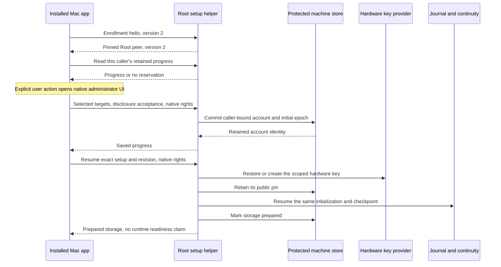
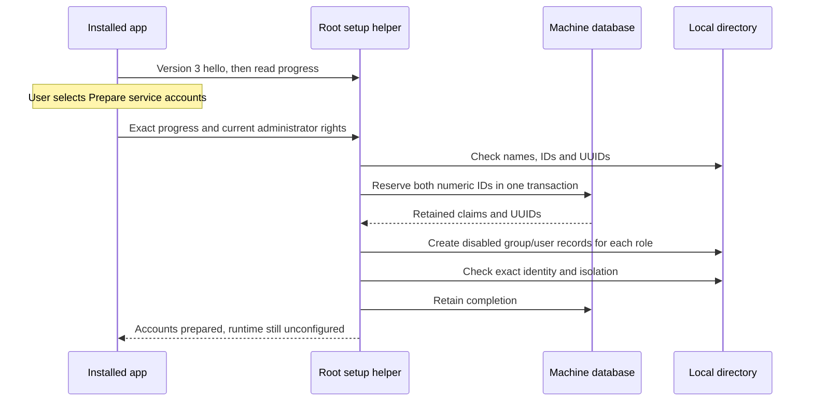
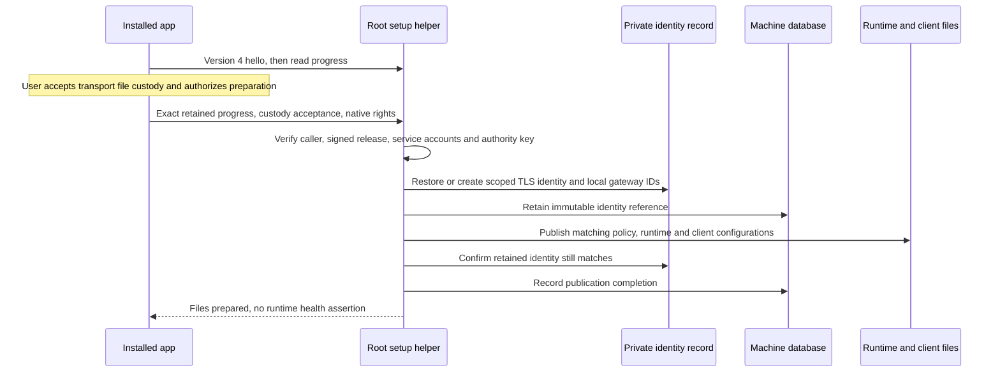

# Mac account preparation

The installed app can prepare command approval storage for its authenticated local Mac account.
The user selects target UIDs and accepts the separate Remozio command policy before administrator authorization.
This policy does not inherit sudoers restrictions.

## Ownership and recovery

The endpoint derives the caller UID from its authenticated XPC invocation.
The helper queries `/Local/Default` for that UID and retains the directory UUID.
A replacement account with the same UID cannot claim the retained preparation.
A primary group change does not replace the account identity.
Each local account receives a separate random Remozio account ID and separate storage directories.

The reservation freezes the installation, release, command grants, initial epoch and current code policy.
It commits before key or journal creation.
Repeated preparation restores those inputs. It cannot replace the grants or create another epoch.
Different grants require a separate future policy-change operation.

The controller pins the key before it starts journal initialization.
Retained initialization checkpoints preserve the journal and continuity boundary across crashes.
Completed preparation never recreates a missing key or database.
A lost reply requires a fresh progress read before another mutation.
Refresh never opens administrator UI or retries a mutation.

## Storage and protocol versions

Explicit account preparation upgrades the machine store to schema 4.
Normal opening and progress reads preserve schemas 1 through 6 without upgrading them.
The added table retains the account reservation independently of the installed-service inventory.
Prepared storage can exist before account service declarations are installed.
It grants no service registration, pairing or command admission.
Existing runtime startup checks still require their complete installed declarations and protected configuration.

The existing storage interface keeps its version 1 hello and operations.
New enrollment operations require a separate version 2 hello.
The app verifies the Root peer before it exports native administrator rights.
Each mutation rechecks native rights, caller scope, current protected release and retained progress.
Signed manifests declare local interface versions 1 through 4, and machine schemas 1 through 6.

## Evidence and remaining gates

Ordinary-owner tests use actual protected leases, SQLite journals and continuity stores.
They cover account isolation, changed directory identity, stale revisions and five interrupted controller stages.
They also cover lost commit replies, a rejected native authorization form and the logical app-to-endpoint sequence.
The native directory lookup reads the current Mac account without changing it.

These controls do not prove Root hardware key provisioning, native XPC admission or an installed administrator approval flow.
Actual privileged installation and service tests remain in issues [#363](https://github.com/rock3r/remozio/issues/363) and
[#374](https://github.com/rock3r/remozio/issues/374).
The app reports storage preparation separately from service readiness.
Service account creation still needs the native installation test.
Runtime file publication is available after service account preparation. Service activation remains the next integration step.
Real device and end-to-end checks still require the user's interactive session.

## Dedicated service accounts

After storage preparation, an explicit app action creates separate transport and gateway accounts.
The app discloses this action before native administrator authorization.
These accounts cannot log in. They have separate primary groups and no home directory with user data.

The allocator checks random candidates between 20000 and 60000, with at most 128 attempts for each role.
It excludes the interactive owner, retained reservations and existing directory records.
Native checks use both the local directory and POSIX lookups.
The database checks both roles together before it reserves either number.
This database belongs to one Mac. It does not introduce a shared registry or a special Mac.

An explicit reservation upgrades the machine database to schema 5.
The saved plan binds the account, release, installation, authority pin and directory UUIDs.
A restart keeps the plan, including partial group or user creation.
The helper reconciles exact records after an unknown write result. It never adopts an unclaimed record or deletes a conflicting record.
Completed setup does not recreate missing accounts or groups.
A lost reply requires Refresh before another action.

The native driver submits disabled authentication, a false shell, an empty home and hidden status in the user creation call.
It checks exact names, numbers and UUIDs before reading the claimed record's authentication policy.
It also checks primary groups, POSIX identity, and administrator and wheel membership.
No account creation runs during ordinary tests.
The [live XPC experiment](experiments/macos-xpc.md#service-account-setup-selectors) also checks the new selectors across separate ordinary-user processes.

The tests use real SQLite transactions and a logical directory fixture.
They cover cross-account reservations, lost commits, malformed records, every controller interruption and rejected administrator rights.
They do not prove native account creation, disabled login, installed XPC or process isolation.
Those checks remain part of the interactive installation gate.

## Runtime file preparation

After service accounts are prepared, the user selects **Prepare runtime files** and accepts private-file custody for the transport TLS key.
The helper requires fresh administrator rights. The authority key remains hardware-backed.
This step prepares files. It does not start services, activate pairing or enable command execution.

The machine database advances to schema 6 only when it retains the identity reference.
The reference includes a digest and public TLS pin. It contains no private transport key.
The private identity record also preserves local gateway identifiers. It does not invent FCM credentials or configure push delivery.
The initial TLS certificate lasts one year. Renewal requires a separate protected transition; setup never replaces an established identity automatically.

Private command and policy files stay under the account's Root-owned runtime directory.
Service-readable files stay outside the private Accounts tree, under a Root-owned directory for that account.
The transport key file has mode 0600 and belongs to the reserved transport user and group.
Transport configuration and app/CLI metadata have mode 0644 and remain Root-owned.
The CLI selects `frontend-UID.cbor`. It uses the legacy shared configuration only when the scoped file does not exist.
Invalid or unreadable scoped configuration never triggers that fallback.

Exclusive publication refuses conflicting bytes, unsafe metadata and links. It never overwrites an existing conflict.
A retry after a lost reply restores the same identity and local gateway IDs.
A retained identity reference prevents regeneration if private material disappears.
Completed progress is historical. Reading it does not repair files, recreate keys or claim that services are healthy.
The command runtime file is a blueprint, not an installed service declaration.
Per-account service registration and the installed command-host wrapper remain required before activation.

Tests cover actual SQLite and owned-file recovery, four interrupted composition stages, authorization refusal, stale progress and explicit app consent.
The [live selector evidence](experiments/macos-xpc.md#runtime-preparation-selectors) covers separate ordinary-user processes.
Native Root ownership, real service account access, activation and Mac–Pixel approval remain interactive gates.
