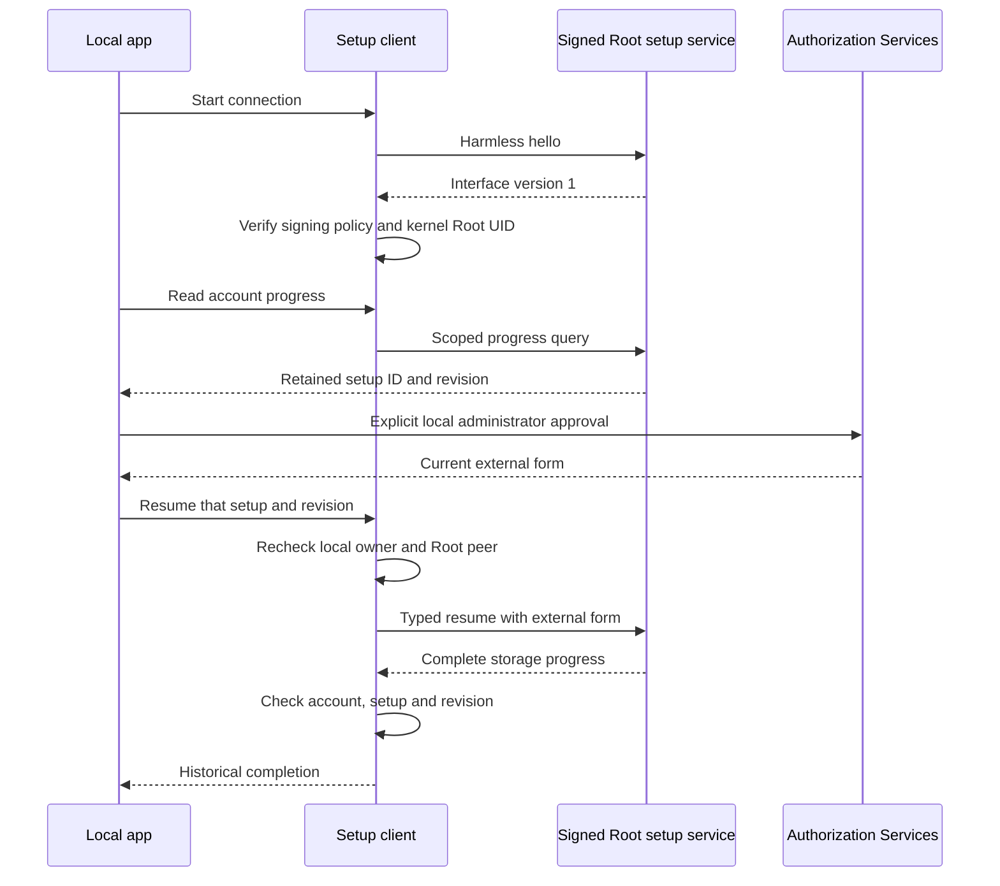

# App connection for administrative setup

The app uses one bounded connection to the Root setup service.
Its service name, code policy, account and owner UID must come from verified protected installation metadata.
The client does not accept these values from a phone or the network.

The signing requirement applies before connection activation. The harmless handshake sends no account or credential data.
Every later native send rechecks the peer's kernel Root UID. Every reply rechecks that identity too.
The client checks its own process and real and effective account identities before each operation.
The caller exports administrator rights only after start succeeds. The client never opens an administrator prompt.
It never logs or persists the supplied external form.

A connection permits one pending operation. The default reply deadline is five seconds.
Cancellation, interruption, timeout and invalid replies close the connection.
Synchronous abort blocks later sends before the actor handles closure.
Late or duplicate replies cannot reopen the channel or complete another operation.

Empty progress means no retained setup intent. It does not prove service health or a usable installation.
A resume reply must identify the same account and setup and report complete storage with a captured checkpoint.
Completion of an incomplete intent must change its revision. An already complete intent must return the same progress.
A lost mutation reply may follow a committed operation. Reconnect and read progress; never resend automatically.

Twelve logical controls cover these boundaries, malformed replies, unsupported versions and the local identity checks.
Removing the handshake guard makes its credential-transfer control fail twelve assertions.
These controls do not prove native signing enforcement, installed XPC behavior or positive administrator consent.
The bundled administrative host, protected startup configuration and app setup UI still need integration.
