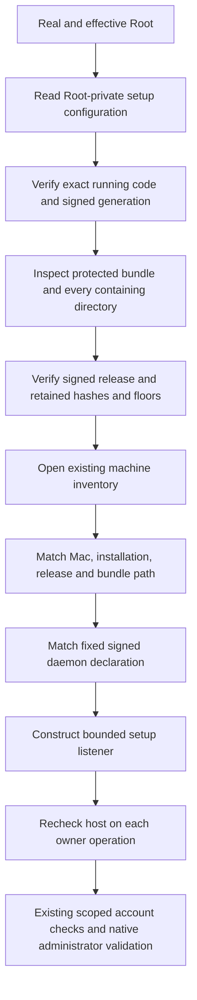

# Bundled administrative setup host

The app now contains `RemozioSetup` and its fixed daemon declaration.
The executable owns the existing setup listener and machine store. It exposes no network listener or approval authority.
It accepts only `--configuration` with the fixed protected setup path.
Ordinary users fail before any configuration read. Invalid arguments never consume stdin or disclose private paths.

The configuration stores current code policy and release identity. Parsing it establishes no installation authority.
Provisioning must publish it from current protected state. Updates must replace it under the coordinated activation boundary.
The host rejects a changed configuration rather than adopting different policy on an existing connection.
It requires the exact installed hashes and generations, including the app hash used to authenticate clients.
A newer signed candidate that clears a floor cannot substitute for the retained current release.

Security.framework supplies the running code path. Command arguments do not supply the bundle location.
The host verifies its own dynamic code identity before opening machine storage.
It verifies Root ownership, local metadata, signed bundle contents and the current inventory before opening the listener.
The setup owner passes its freshly read inventory to host validation before checking progress or resuming storage.
Moving the recorded bundle or removing or changing its setup declaration refuses the operation.
Listener shutdown precedes machine-store and protected-placement lease closure.

The fixed plist binds the helper path, Root account, configuration argument and local Mach name.
Its signature is part of the containing app seal. Matching these bytes is not proof of actual service registration.
The installer must independently verify registration and authorization before publishing usable setup inputs.
No check in this change registers a job, creates an OS account or initializes fresh machine inventory.
Missing protected setup state prevents startup. No fallback launches Root code from the downloaded app location.

Nine new controls cover canonical input, exact release policy, installation and service scope,
Root refusal, native self-code inspection, and host changes before storage mutation.
The combined host, client, endpoint, listener, manifest and signed bundle controls pass 56 tests.
Removing the retained hash check makes the release-policy control fail. Restoring it passes.
Both app build configurations verify the embedded executable, signed generation, daemon bytes and refusal behavior.
These builds use development signatures; they do not prove Developer ID installation or native Root execution.

Fresh bootstrap, actual registration, service account creation, configuration publication and the app setup screen remain unfinished.
Positive native administrator consent, installed XPC behavior and Mac–Pixel approval remain interactive gates.
