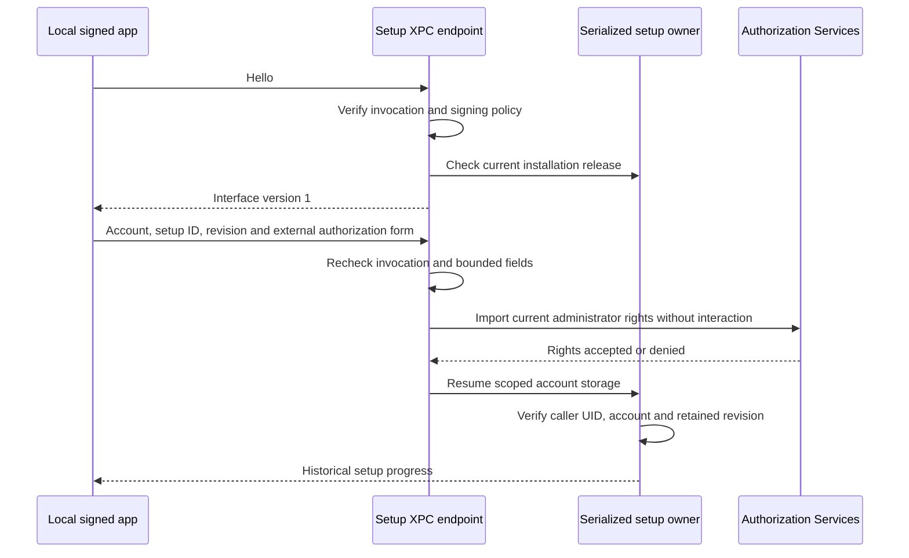

# Local administrative setup IPC

The version 1 interprocess communication (IPC) interface supports a harmless handshake, scoped storage progress and account storage resume.
It has no signing, password release, command execution or cloud management method.

The endpoint binds each operation to its accepted NSXPC connection and kernel credentials.
Its signing requirement applies before connection activation. The listener must enforce the same policy.
The client must authenticate the Root endpoint and finish the handshake before sending an external authorization form.
The form stays inside that exported invocation. The endpoint does not retain, persist or forward it.

One owner holds the protected machine store and serializes operations from every accepted connection.
It binds the store to the expected current release and installation identity.
The caller's kernel UID must match the account owner in retained inventory.
A changed installation, release, setup ID or revision refuses before storage resume.
Progress contains only account and setup IDs, the revision and two storage flags.
It contains no credential, path, code policy or current runtime health assertion.

Eleven endpoint controls cover handshake order, scoped progress, native uncredentialled authorization refusal,
logical fixture completion, account isolation, repeated invocation checks, stale progress, release changes,
malformed forms, shared-owner concurrency, the public Root gate and malformed progress decoding.
The logical fixture authorizer does not prove native administrator consent.
Removing administrator validation causes the native-denial control to fail four times.
Restoring validation passes the combined endpoint, storage setup and authorization controls.

The product host must verify its signed release, protected placement and code floors before opening the owner.
Public owner opening and endpoint construction require real and effective Root.
The bundled executable, listener registration, client handshake and setup UI still need integration.
Positive native consent, installed XPC behavior and full Mac–Pixel approval remain interactive gates.
