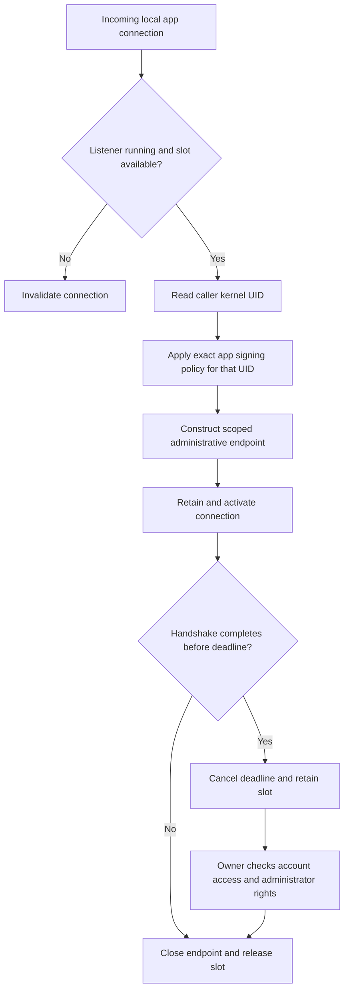

# Bounded administrative setup listener

The Root Mach listener retains accepted connections through a shared reservation registry.
A reservation covers construction and handshake. It does not wait for a free connection slot.

The same approved app signing policy applies at listener and connection boundaries.
Each accepted connection receives its own kernel UID binding.
The setup owner separately checks that UID against the requested account owner.
The listener therefore does not designate one account as the owner of every administrative connection.
Root callers and invalid kernel UIDs cannot establish app connections.

Successful handshake notification retains the connection reservation and cancels its deadline.
Endpoint closure removes that reservation once. Failed construction returns only its own slot.
Shutdown closes retained endpoints before the host closes the shared setup owner.
Defaults are eight connections and a five-second handshake deadline. The host can configure both within bounded ranges.
The listener creates no network socket and performs no service registration.

Five setup lifecycle controls run with real protected machine storage and logical endpoint verification.
They cover successful handshake, stalled deadline, rejected handshake, shared-owner shutdown and the public Root requirement.
The combined lifecycle, endpoint and registry suite passes 23 controls.
Removing successful handshake notification causes its reservation control to fail three times.
Restoring notification passes the focused suite.
These controls do not prove native signing enforcement, installed Mach check-in or native administrator consent.

The administrative executable, protected startup configuration, verified placement and app handshake remain unfinished.
The host must establish those requirements before starting the listener.
Installed service behavior and complete Mac–Pixel approval remain interactive gates.
