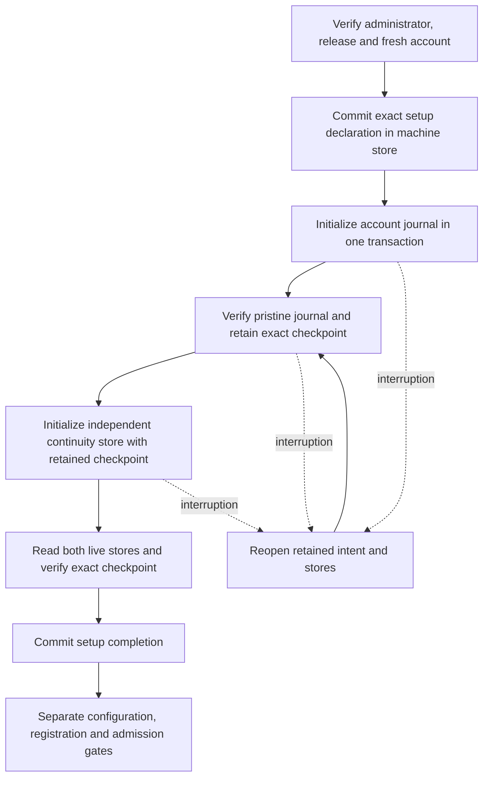

# Durable account initialization

The machine store retains account setup progress before the account journal initializes.
It uses the existing installation writer lock and transaction owner.
The explicit begin operation commits its first intent and the storage upgrade from version 2 to version 3 in one transaction.
Ordinary reads do not upgrade storage.
Preparation records and inventory remain available after the upgrade.

The intent retains the installation, Mac, account, release, database paths and exact authority declaration.
That declaration includes the original epoch, code policy, capabilities, allowed contracts and replay setting.
The retained digest binds these inputs. Decoding does not authenticate a release or administrator.
The setup host must establish those proofs before beginning an intent or initializing an empty store.

Checkpoint capture requires the initial schema, exact declaration and pristine table contents.
It rejects retained enrollments, outcomes, additional epochs and changed routing state.
The candidate cannot change after capture. A stale revision cannot advance the intent.
A changed installation, release or account cannot resume it.

Completion verifies both protected paths and separate directory identities.
Neither account store directory can contain the other. Setup and runtime enforce the same invariant.
It reads the live journal and continuity store and requires the exact retained checkpoint.
Pending checkpoint changes, recovery state and journal mismatches refuse completion.
This check does not repair, reinitialize or alter either account store.
An uncertain commit retires the machine connection. Reopening observes whichever state committed.
Completed intents remain retained and cannot be replaced by a new begin operation.

Eleven new controls cover restart gaps, lost acknowledgments, changed inputs, stale revisions, retained history,
checkpoint mismatches, corrupt records, directory containment, distinct descriptor limits and the public Root requirement.
The combined suite passes 33 controls, including existing inventory and atomic journal initialization controls.
These tests use ordinary-owner files and real SQLite transactions. They do not prove power-loss durability.

The [account storage controller](macos-account-initialization-controller.md) now composes these stages.
The product setup host must authenticate and authorize its typed operation.
It must not infer fresh setup from empty files. Runtime startup must not perform setup initialization.
Completion is storage evidence only. It grants no enrollment, command target, service registration or runtime admission.
The controller, service integration and real Mac–Pixel approval remain unfinished.
