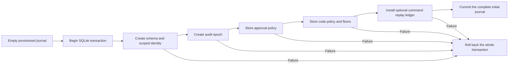

# Atomic initial authority journal

`JournalDatabase.open` accepts an optional `AuthorityJournalInitialization` during explicit initialization.
The public authority path requires both process identities to be Root.
The setup host must already validate administrator authorization, signed code, placement, fresh-installation intent and scope.
The declaration supplies none of those proofs.

The initial epoch, approval policy, code policy and optional replay ledger now commit with the schema.
A failure at any bootstrap stage leaves no committed schema or partial authority policy.
Reinitialization refuses retained stores without changing their bytes.
A non-initializing call or mismatched descriptor scope refuses before SQLite opens.
Existing storage-only initialization remains available for its separate callers.

The initial approval policy contains no phone enrollment. It supplies no command target grant.
Code policy inputs still need independent verification; construction does not authenticate a release.
The declaration exposes no callback or generic privileged operation. Fault hooks exist only in the internal fixture initializer.

Seven controls use actual provisioned files and SQLite transactions.
They cover every injected stage failure, invalid policy rollback, retained reopen, scope mismatch, existing profiles and independent checkpoint composition.
Committing the schema early makes the rollback control fail. Restoring one transaction passes the focused controls.
The combined initialization and file provisioning suite passes 22 controls. No Root or device operation ran.

The independent continuity checkpoint remains a separate store. Its composition test reconciles a completed bootstrap after reopening.
This does not make initialization across both stores atomic.
The product setup controller still needs a durable setup intent to resume the journal-to-checkpoint boundary safely.
It must not infer fresh setup from empty files or use initialization as ordinary recovery.
Real Root setup, hardware custody, service installation and physical approval remain interactive gates.
