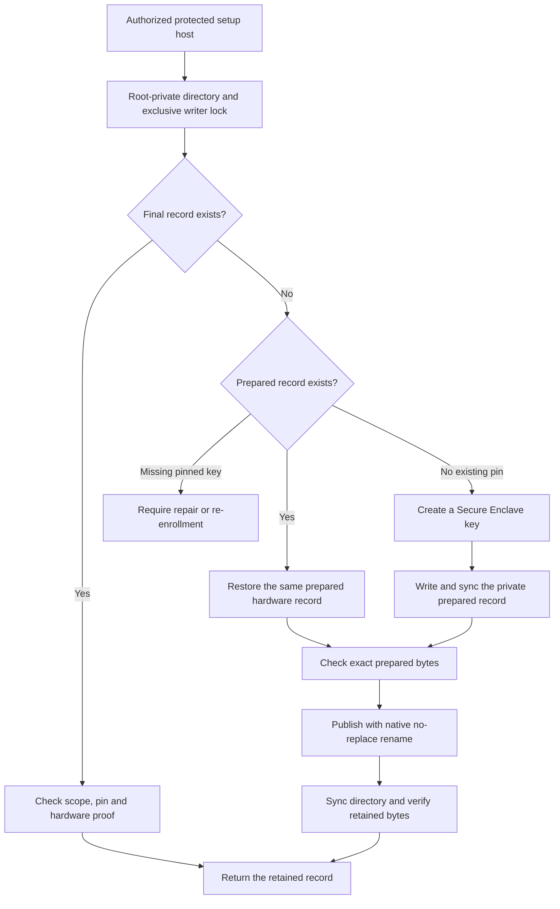

# Authority key provisioning

`AuthorityKeyProvisioning.restoreOrCreate` restores or creates a hardware-only authority identity for one Mac/account during privileged setup.
The public API requires real and effective Root identity.
It creates no parent directory, account, service or enrollment.
The setup host must first verify administrator authorization, its code and the protected installation.
An established identity must supply its retained public-key pin. A missing pinned record never creates a replacement.

The public result contains only the Mac ID, account ID and public key. It never carries wrapped key bytes.
The final basename is `authority-key.cbor`. The directory budget includes the complete runtime reader path. The directory must already be Root-owned and private.
The setup owner validates local ancestry, ACLs, modes, inode identities, process ownership and the writer lock.
Records use the existing bounded authority key format. Their wrapped representation never belongs in a shared setup export.

Creation uses Secure Enclave P-256 and device-only access after first unlock. Authentication dialogs are disabled.
Restoration proves the retained public key with a fixed-purpose hardware signature. The proof grants no approval or enrollment authority.
There is no software fallback or implicit key replacement.

A complete prepared record survives an interrupted publication. A final record survives an uncertain return after rename.
Recovery reuses those exact bytes and checks the supplied pin. It never overwrites an existing destination.
Malformed, inaccessible or conflicting records require repair. Incomplete initial writes remain visible; they are not silently discarded.
The ordinary-owner tests inject faults at storage boundaries. They do not prove power-loss durability.

Twelve storage tests cover continuity, interrupted publication, missing pins, wrong scope, hardware failure, conflicting state, exclusive ownership and protected metadata.
An additional signer test rejects software key bytes in the hardware proof.
Storage fixtures use software public points and opaque test bytes through internal callbacks. They do not certify hardware custody.
Root creation, Root key restoration, pre-login access and installed setup remain interactive platform gates.
The product setup controller still needs to call this API before constructing its authority configuration and trusted public pin.
