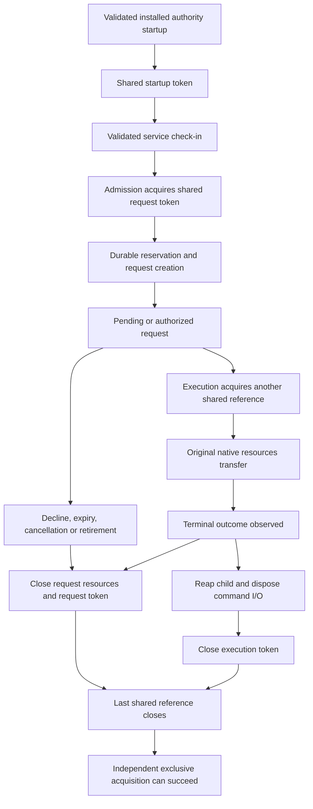

# Authority release activity

The installed command authority now retains machine activity for each admitted request.
Native execution retains a separate reference until the child and its I/O resources finish cleanup.
Closing the journal cannot release that execution reference early.

This implements one participant in the future update barrier. It does not enable bundle replacement or automatic updates.

## Ownership

An exclusive attempt is nonblocking. A busy attempt leaves normal request admission available.
An exclusive owner blocks new shared acquisition until it closes its token.
The installer must use its own descriptor. It cannot upgrade an authority's shared descriptor.

Command refusal uses the existing authenticated admission result and submission binding.
An installation refusal reports `notAdmitted(updateInstalling, updateInstalling)` only after checking that no retained or durable reservation contradicts it.
A duplicate submission remains uncertain. Rejected journal writes release the provisional activity reference.

## Protected coordination file

Fresh installation storage publishes `activity.lock` before `installation.sqlite`.
The empty file has Root ownership, mode `0600`, no extra links, and no granting ACL.
An interrupted fresh setup retains the published file on retry.
An existing installation database with a missing activity file requires explicit recovery. Setup never silently recreates that inode.

The authority opens the existing file through protected directory descriptors.
It checks ownership, permissions, ACLs, local storage, retained inode identity, empty content, and close-on-exec flags.
Every acquisition and the final dispatch boundary recheck the retained identity.
A validation failure retires request handling. Existing native cleanup retains its kernel lock until resource disposal finishes.

Multiple references in one authority share one open file description.
Independent authorities and the future installer use independent descriptions.
The last reference closes its descriptor. No activity path calls `LOCK_UN`.

## Validation and remaining boundaries

Ordinary-account tests cover independent owners, nonblocking installation attempts, repeated close, token destruction, file replacement, unsafe files, and many references.
Actual command fixtures cover installation refusal, retry, duplicate uncertainty, failed commits, failed spawn, changed-file refusal, and cleanup after journal closure.
These fixtures use ordinary credentials and synthetic signing policies. They do not establish installed Root behavior.

The [native mechanism experiment](experiments/release-activity.md) also ran on macOS 26.6.2 and 27.0.1.
The [macOS 26 CI record](experiments/evidence/2026-10-16-release-activity-ci.json) identifies the exact source and job.

The [installed setup host and Root pairing endpoint](macos-setup-pairing-release-activity.md) also retain machine activity.
The app, transport, gateway, GUI permits and other role work still need complete coordinated activity ownership.
The raw component runtime keeps its optional fixture path. Installed command startup always supplies this barrier.
The installer still needs staging validation, service quiescence, generation and protocol checks, durable activation, floor commit, and crash recovery.
An exclusive token alone cannot authorize activation or prove that every role is idle.

An upgrade from older storage needs a validated migration under complete service quiescence.
The current developer package remains limited to fresh installation or same-build recovery.
No automatic admission freeze, command termination, pairing reset or recurring prompt is added here.
