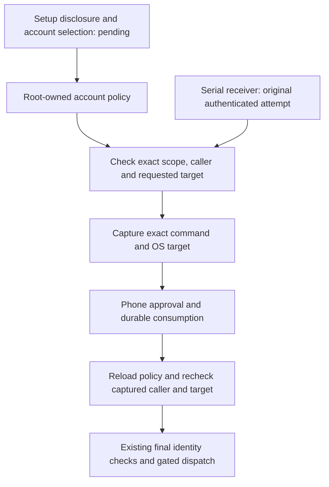

# Independent command elevation policy

The user selected a separate Remozio policy on 11 October 2026.
Setup must disclose this authority and configure explicit account and target-user grants.
Remozio does not inherit sudoers restrictions or execution settings.

| Source | Effect |
| --- | --- |
| Enrolled Mac account and configured target UID | Defines a permitted caller and execution target |
| Mac administrator membership | Grants no automatic Remozio access |
| Exact phone approval | Remains required for each command |
| Empty target set | Disables command elevation for this account |
| Missing, unreadable or revoked policy | Prevents execution without a cached-policy or sudo fallback |

## Policy component

`CommandElevationPolicy` encodes bounded canonical CBOR with a version, independent-policy marker, Mac ID, account ID, caller UID, sorted target UIDs, and disclosure acceptance.
It accepts only version 1. Duplicate targets, unknown fields, unsupported versions and missing disclosure acceptance are rejected.
Target UID 0 is supported only through an explicit grant. The caller must be an ordinary account.
The native resolver uses a bounded passwd buffer and group array, preserves the primary group, and sorts distinct supplementary groups.

The policy checks the authenticated Mac/account scope and caller UID before target resolution.
A capture recheck also requires matching real and effective caller UIDs and a currently allowed target UID.
The policy does not trust the submitted target name or group list. The native resolver obtains the current UID, primary GID, supplementary groups and account name from the OS.
Capture validation rejects changed groups, GID or account name, and fails if the account cannot be resolved.

The diagram shows the component composition. The application does not yet install or activate protected command dispatch.
The production loader requires existing Root-owned private metadata and protected ancestors.
Decoding arbitrary bytes does not establish installation provenance or grant execution authority.

## Setup disclosure and remaining integration

Setup must explain that Remozio can allow a command that sudoers would refuse.
The user must choose the enrolled caller account and allowed target users. Do not infer grants from administrator membership.
Machine-specific grants are scoped to their Mac and account; importing shared setup configuration does not transfer those grants.

`CurrentCommandElevationPolicy` retains only the protected loader and configured Mac, account and caller scope. It reloads grants for each resolution and validation. A failed read has no cached fallback.

The journal admission overload uses the original authenticated handshake scope and caller UID. It checks grants before filesystem capture. It rechecks the capture before and after trusted draft construction, before publishing the request.

The execution overload checks the policy scope against the current journal before creating a controller. It supplies the fresh validator to the existing pre-spawn and pre-release checks. The callback reads the protected policy without journal reentry.

The serial receiver worker has a current-policy constructor. It passes the original authenticated attempt to the journal operation. It retains one receive queue and the shared journal, clock and epoch.
The trusted stream-metadata factory runs after grant checks, inside admission. A factory failure returns typed uncertainty before filesystem capture. Imported resources close; borrowed caller descriptors remain open. An ordinary account cannot construct the production worker.

Before activating execution, complete protected service registration and the native target-group experiment in [issue 298](https://github.com/rock3r/remozio/issues/298). Preserve the full OS group identity; do not truncate groups or silently reject Root targets.
The existing enrollment, signature, capture, caller-lifetime, durable-consumption and execution checks remain required.
The 1Password and Little Snitch adapter contracts remain unchanged.

Tests cover scope and account isolation, target removal, disabled grants, captured caller changes, rejected encodings and unprivileged protected-file loading.
Journal fixtures also cover policy rejection before capture, actual OS credential capture, revocation during draft construction and read failures at each admission check. They verify that failed admission creates no request reservation or audit event. Receiver fixtures also cover grant revocation between requests, stream-metadata failure, typed replies and a healthy queue after denial.
These fixtures use internal identity seams; they do not prove installed Root execution.
No privileged service was installed or launched for these checks.
